# Design Document: AWS Cyber Recovery — Protected Recovery Environment (PRE)

## Overview

This document defines the technical architecture for an AWS Cyber Recovery Solution that transforms the existing Disaster Recovery (DR) VPC in `eu-central-1` into a Protected Recovery Environment (PRE). The PRE serves as a hardened, trust-verified staging environment where workloads — restored from Rubrik backups through the Isolated Recovery Environment (IRE) — are cleansed, validated, and approved before promotion back to production.

The design addresses three core security objectives: stopping attacker access to the DR VPC, establishing clean workload provenance, and preventing attacker re-entry. It achieves this through dedicated admin identities, independent KMS key hierarchies, hardened network controls, and a formal break-glass access mechanism — all while maintaining secure connectivity to the ISO Environment's foundational shared services.

The PRE is intentionally designed as an air-gapped, independently administered environment that shares no credential, key, or network trust chain with the potentially compromised production environment. This document covers both a High-Level Design (architecture, topology, trust boundaries, data flows) and a Low-Level Design (IAM policies, KMS key structure, VPC/subnet/NACL/SG configuration, TGW attachments, security tool integration, and the IRE→PRE→Prod promotion workflow).

---

## Corrected Account Model

The architecture uses three AWS accounts within the same AWS Organization OU:

| Account | Label | Contents |
|---------|-------|----------|
| **Account A** | Prod+PRE Account | Contains BOTH the Prod VPC (`eu-west-1`, `10.0.0.0/16`) AND the PRE/DR VPC (`eu-central-1`, `10.1.0.0/16`) — two VPCs in the same AWS account |
| **Account B** | IRE Account | The Isolated Recovery Environment — a separate AWS account within the same OU |
| **Account C** | ISO Account | Shared services (AD, DNS, Terraform, GitHub, Azure DevOps, GCP, Certs, TGW ownership) — a separate AWS account within the same OU |

**Critical implication**: Because Prod VPC and PRE VPC reside in Account A (the same AWS account), account-level SCPs cannot isolate them from each other. Isolation between Prod IAM roles and PRE IAM roles is enforced via IAM permission boundaries, IAM role trust policies, and resource-based policies on PRE KMS keys and S3 buckets — not via SCP account boundaries. SCPs at the OU level apply uniformly to all three accounts as baseline guardrails only.

---

## Part 1 — High-Level Design

---

## Architecture Overview

The recovery architecture consists of four distinct trust zones connected through controlled network paths:

1. **Production Zone** (`eu-west-1`, Account A) — potentially compromised; source of backed-up workloads via Rubrik
2. **ISO Environment** (Account C) — trusted foundational shared services (AD, DNS, Terraform, GitHub, Azure DevOps, GCP connectivity); owns the Transit Gateway, shared via AWS RAM
3. **IRE (Isolated Recovery Environment)** (Account B) — quarantined restore target; workloads arrive here from Rubrik and are scanned
4. **PRE (Protected Recovery Environment)** — the DR VPC in `eu-central-1` within Account A, re-purposed and hardened as the trusted staging environment

The PRE uses the existing DR VPC infrastructure but is treated as a new trust boundary. All prior network paths, IAM trust relationships, and credentials associated with Prod are severed. New independent identities, keys, and network controls are provisioned within Account A. Because Prod VPC and PRE VPC coexist in Account A, isolation is enforced at the IAM layer (permission boundaries, role trust policies, resource-based deny policies) and the network layer (no VPC peering between the two VPCs; TGW route table blackholes the Prod CIDR on the PRE attachment).

---

## System Architecture Diagram

```mermaid
graph TB
    subgraph AccountA["Account A — Prod+PRE Account"]
        subgraph PROD["Production Zone — eu-west-1 (Potentially Compromised)"]
            ProdVPC["Prod VPC\n10.0.0.0/16"]
            Rubrik["Rubrik Backup Agent"]
            ProdApp["Production Workloads"]
            ProdIAM["Prod IAM Roles\n(Untrusted during incident)"]
        end

        subgraph PRE["PRE — DR VPC eu-central-1 (Hardened Staging)"]
            PREVPC["PRE VPC\n10.1.0.0/16\n(re-purposed DR VPC)"]

            subgraph PRESubnets["PRE Network Segments"]
                MgmtSubnet["Management Subnet\n10.1.0.0/24"]
                WorkloadSubnet["Workload Subnet\n10.1.1.0/24"]
                ScanSubnet["Security Scan Subnet\n10.1.2.0/24"]
                EgressSubnet["Controlled Egress Subnet\n10.1.3.0/24"]
            end

            PRETGW["TGW Attachment\n(PRE-side, RAM-shared TGW)"]
            BreakGlass["Break-Glass\nAccess Mechanism"]
            PREKMS["PRE KMS Key Ring\n(Independent, same account\nbut Prod roles explicitly denied)"]
            PREIAM["PRE IAM Roles\npre-* prefix\nPermission boundary: eu-central-1 only"]

            Tanium_PRE["Tanium Agent"]
            CrowdStrike_PRE["CrowdStrike Sensor"]
            Qualys_PRE["Qualys Scanner"]

            RecoveredWL["Recovered &\nValidated Workloads"]
            ApprovalGate["Approval Gate\n(Manual + Automated)"]
        end

        ProdVPC -.-x|"NO VPC PEERING\nNO DIRECT PATH\n(TGW blackholes Prod CIDR\non PRE attachment)"| PREVPC
    end

    subgraph AccountC["Account C — ISO Account (Trusted)"]
        ISOTGW["Transit Gateway\n(owned by ISO Account C\nshared via RAM to Accounts A & B)"]
        MSAD["Microsoft AD\nAuthentication"]
        DNS["DNS Resolver"]
        CertMgmt["Certificate Authority"]
        GitHub["GitHub"]
        AzDevOps["Azure DevOps"]
        Terraform["Terraform Runner"]
        GCPConn["GCP Connectivity"]
        SecurityHub["Security Hub /\nLog Aggregation"]
    end

    subgraph AccountB["Account B — IRE Account (Isolated Recovery Environment)"]
        IREAccountBoundary["IAM Account Boundary"]
        IREVPC["IRE VPC\nQuarantine Zone"]
        RubrikRestore["Rubrik Restore Target"]
        Tanium_IRE["Tanium Agent"]
        CrowdStrike_IRE["CrowdStrike Sensor"]
        Qualys_IRE["Qualys Scanner"]
        IREScan["Workload\nCleansing & Scan"]
    end

    Rubrik -->|"Backup Data"| RubrikRestore
    IREScan -->|"Cross-account AMI copy\n(Account B → Account A)\nRe-encrypted with alias/pre-workload"| RecoveredWL

    PRETGW <-->|"RAM-shared TGW\n(ISO services only)"| ISOTGW
    IREVPC <-->|"RAM-shared TGW\n(for Tanium/scan callbacks only)"| ISOTGW

    MSAD -->|"PRE Admin Auth\n(dedicated OU)"| MgmtSubnet
    DNS --> PREVPC
    CertMgmt --> PREVPC
    Terraform -->|"IaC Deployment\nto PRE only"| PREVPC

    Tanium_IRE -.->|"Pre-approved\nscan access"| IREScan
    CrowdStrike_IRE -.->|"Pre-approved\nscan access"| IREScan
    Qualys_IRE -.->|"Pre-approved\nscan access"| IREScan

    Tanium_PRE -.->|"Continuous\nmonitoring"| RecoveredWL
    CrowdStrike_PRE -.->|"EDR coverage"| RecoveredWL
    Qualys_PRE -.->|"Vulnerability\nscanning"| RecoveredWL

    ApprovalGate -->|"Approved\nworkloads only"| PromotedWL["Recovered Production\n(Prod VPC, Account A)"]
```

---

## Trust Boundaries and Zone Definitions

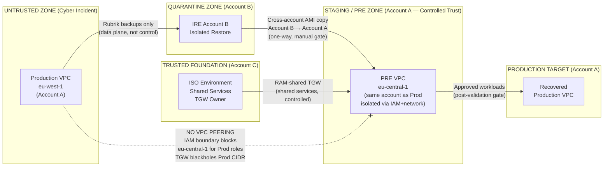

**Zone Trust Rules:**

| Zone | Account | Trust Level | Communication Direction |
|------|---------|------------|------------------------|
| Production VPC (incident) | Account A | Untrusted | Outbound to Rubrik only; blocked from PRE VPC |
| IRE | Account B | Quarantine | Receives from Prod via Rubrik; sends cleansed AMI to Account A PRE via cross-account copy |
| ISO Environment | Account C | Trusted | Bidirectional with PRE (shared services only via RAM-shared TGW) |
| PRE VPC | Account A | Controlled Trust | Receives AMI from Account B; consumes ISO services; promotes to Prod VPC |
| Recovered Production | Account A | Target | Receives approved workloads from PRE |

**Intra-Account Isolation (Account A — Prod VPC vs PRE VPC):**

Since both VPCs reside in Account A, isolation depends on layered controls rather than account boundaries:
- **Network**: No VPC peering between Prod VPC and PRE VPC. TGW route table for the PRE attachment blackholes `10.0.0.0/16`. NACLs on PRE subnets explicitly DENY all traffic from `10.0.0.0/16`.
- **IAM**: PRE roles (`pre-*`) carry a `PREPermissionBoundary` restricting all actions to `eu-central-1`. Prod roles operate in `eu-west-1` and have no cross-region access. PRE role trust policies only trust the ISO SAML provider — not any Prod EC2, Lambda, or other service principal.
- **Resource policies**: PRE KMS key policies and PRE S3 bucket policies contain explicit DENY statements for all Prod IAM role ARNs (by `arn:aws:iam::<ACCOUNT_A_ID>:role/prod-*` or equivalent naming prefix/tag).

---

## Data Flow: Cyber Recovery Sequence

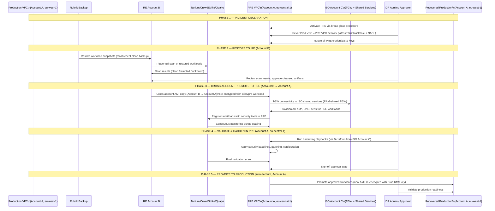

---

## Network Topology

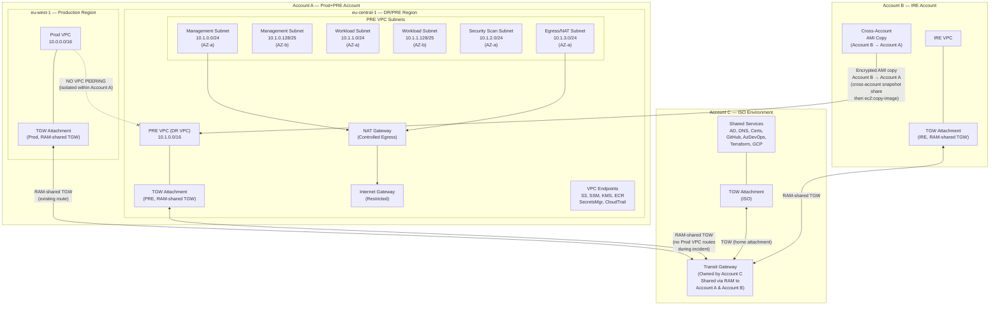

---

## Key Components Summary

| Component | Purpose | Account | Location |
|-----------|---------|---------|----------|
| PRE VPC (DR VPC) | Hardened staging environment | Account A | `eu-central-1` |
| Prod VPC | Production (potentially compromised) | Account A | `eu-west-1` |
| PRE IAM Roles (`pre-*`) | Dedicated DR admin identities | Account A | AWS IAM (PRE-scoped via boundary) |
| PRE KMS Key Ring | Independent encryption keys for PRE | Account A | AWS KMS `eu-central-1` |
| Transit Gateway | Controlled connectivity between all zones | Account C (owner) | Shared via RAM to A & B |
| Break-Glass Mechanism | Emergency out-of-band access | Account A | AWS Secrets Manager + IAM role |
| Rubrik | Backup and restore orchestration | On-premises / multi-cloud | — |
| IRE Account | Quarantine zone for initial restore | Account B | Separate AWS account |
| Tanium / CrowdStrike / Qualys | Security scanning and EDR | Agents in Account A/B | Pre-approved access to PRE |
| Microsoft AD (ISO) | Authentication for PRE admin identities | Account C | ISO Environment |
| Terraform (ISO) | IaC deployments into PRE | Account C | ISO Environment |
| VPC Flow Logs | Network traffic visibility | Account A | CloudWatch / S3 (PRE-dedicated buckets) |
| AWS CloudTrail | API audit trail (all regions, Account A) | Account A | S3 (PRE-dedicated, Object Lock) |
| AWS Config | Configuration compliance monitoring | Account A | PRE region (`eu-central-1`) |

---

## Security Architecture Principles

1. **Zero Trust toward Production VPC during incident** — No VPC peering exists between Prod VPC and PRE VPC. The TGW route table for the PRE attachment blackholes `10.0.0.0/16`. NACLs on all PRE subnets explicitly DENY all traffic from/to `10.0.0.0/16`. Prod IAM roles have no access to PRE resources due to resource-based deny policies and permission boundary region-lock.

2. **Independent Key Management** — PRE KMS keys reside in the same account (Account A) as Prod KMS keys but are created and administered by the dedicated `pre-dr-kms-admin` role. Every PRE KMS key policy carries an explicit DENY statement for all Prod IAM role ARN patterns. No Prod role can encrypt, decrypt, or administer PRE keys.

3. **Dedicated Admin Identity Plane** — PRE administrators authenticate via a dedicated AD Organizational Unit (OU) in the ISO Microsoft AD (Account C). Federated IAM roles are scoped exclusively to `eu-central-1` via permission boundaries. No shared credentials with Prod admins. AWS IAM Identity Center enforces separate login paths: Prod admins receive permission sets targeting `eu-west-1` resources; DR admins receive permission sets targeting `eu-central-1` resources via `pre-*` roles.

4. **Defense in Depth Networking** — Traffic is controlled at four layers: TGW route tables (Account C owned), VPC NACLs (Account A, PRE VPC), security groups (Account A, PRE VPC), and host-level firewall (via Tanium/CrowdStrike policy enforcement). VPC Flow Logs on the PRE VPC provide full visibility.

5. **One-Way Artifact Promotion** — Workload artifacts flow from IRE (Account B) → PRE (Account A) via a cross-account AMI copy. There is no network path between the two accounts at the VPC level. The TGW is not used for data transfer between IRE and PRE — only for security tool callbacks to ISO.

6. **Immutable Audit Trail** — CloudTrail in Account A covers all regions including `eu-central-1` (PRE). Logs are written to a dedicated, write-once S3 bucket in Account A with Object Lock enabled. VPC Flow Logs for the PRE VPC are stored in separate PRE-dedicated buckets, not shared with Prod.

7. **Intra-Account Isolation Layers** — Since Prod and PRE share Account A, isolation is explicitly enforced at every layer: IAM permission boundaries (region-lock), role trust policies (SAML-only, no Prod service principals), KMS key policies (explicit DENY for Prod role ARNs), S3 bucket policies (explicit DENY for Prod role ARNs), and network controls (no VPC peering, TGW blackhole, NACL deny).

---

## Architecture

The PRE architecture layers four distinct trust zones — Production VPC (untrusted during incident, Account A), IRE (quarantine restore, Account B), ISO Environment (trusted shared services + TGW owner, Account C), and PRE VPC itself (Account A) — connected through a central Transit Gateway owned by Account C and shared via AWS RAM. The PRE VPC (`eu-central-1`, `10.1.0.0/16`) re-purposes the existing DR VPC but severs all prior trust relationships with the Production VPC. Critically, both VPCs coexist in Account A, so isolation is enforced at the IAM and network layer rather than account boundary: no VPC peering, TGW route blackhole for Prod CIDR, NACLs with explicit DENY, permission boundaries restricting PRE roles to `eu-central-1`, and resource-based DENY policies on all PRE KMS keys and S3 buckets targeting Prod role ARN patterns. Terraform pipelines originate from Account C (ISO) and deploy into PRE, ensuring the Account A identity plane cannot modify its own infrastructure-as-code state.

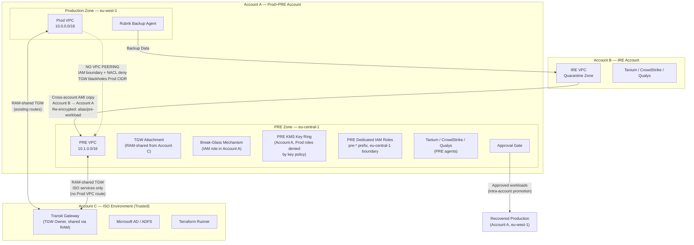

---

## Components and Interfaces

### Component 1: PRE VPC Network Layer

**Purpose**: Provides isolated, hardened network environment for recovered workloads with controlled ingress/egress and deep packet visibility. Isolation from the Prod VPC (which is in the same Account A) is enforced via absence of VPC peering, TGW route blackhole, and explicit NACL DENY rules.

**Interface**:

```pascal
COMPONENT PREVPCNetworkLayer
  PROVIDES:
    - Subnet isolation (management, workload, scan, egress)
    - NACL + Security Group dual-layer filtering
    - VPC Flow Logs (ALL traffic, CloudWatch + S3, PRE-dedicated buckets)
    - VPC Endpoints (SSM, KMS, S3, Secrets Manager, CloudTrail, Config)
    - Route 53 Resolver outbound (DNS forwarding to ISO Account C)
    - NAT Gateway (controlled egress for security tool cloud callbacks)
  CONSUMES:
    - RAM-shared Transit Gateway (Account C owner) for ISO connectivity
    - AWS KMS (encryption for Flow Logs, using alias/pre-s3)
  CONSTRAINTS:
    - No VPC peering between PRE VPC and Prod VPC (intra-account isolation)
    - No default route to Production VPC CIDR on TGW PRE attachment route table
    - TGW route table for PRE attachment blackholes 10.0.0.0/16
    - NACL explicit DENY rules for Production CIDR (10.0.0.0/16)
    - All inbound from internet blocked (no IGW inbound routes)
END COMPONENT
```

**Responsibilities**:
- Enforce network-level isolation between PRE VPC and Prod VPC at NACL layer
- Route all AWS API calls through VPC Interface Endpoints (no internet traversal)
- Forward internal DNS queries to ISO AD DNS (Account C) via Route 53 Resolver outbound endpoint
- Log all accepted and rejected traffic to CloudWatch Logs and S3 with Object Lock

### Component 2: PRE IAM Identity and Access Layer

**Purpose**: Provides dedicated, isolated identity and access management for the PRE environment within Account A, completely independent of Production IAM roles. Because Prod and PRE share Account A, isolation relies on permission boundaries, role trust policies, and resource-based deny policies rather than account-level SCPs.

**Interface**:

```pascal
COMPONENT PREIAMLayer
  PROVIDES:
    - Federated IAM roles via SAML (ADFS from ISO AD in Account C)
    - Permission boundaries on all PRE roles:
        - Region-lock: eu-central-1 only
        - Deny sts:AssumeRole targeting any Prod role ARN pattern
        - Deny IAM privilege escalation actions (non-admin roles)
    - IAM role set: pre-dr-admin, pre-dr-network-admin, pre-dr-kms-admin,
                    pre-dr-readonly, pre-break-glass, pre-automation-deploy,
                    pre-workload-instance, pre-scan-tool-access
    - AWS IAM Identity Center separate permission sets for DR admins vs Prod admins
  CONSUMES:
    - ISO Microsoft AD (via RAM-shared TGW) for SAML federation
    - AWS IAM Identity Center for SSO integration
  CONSTRAINTS:
    - PRE roles trust ONLY the ISO SAML provider — not Prod EC2/Lambda service principals
    - Permission boundary locks all PRE roles to eu-central-1 (Prod roles operate in eu-west-1)
    - MFA required for all role assumptions
    - KMS admin role CANNOT perform data encryption/decryption operations
    - Break-glass role requires dual-person authorization
    - Prod role ARNs are explicitly denied in PRE KMS key policies and S3 bucket policies
END COMPONENT
```

**Responsibilities**:
- Federate PRE admin identities from dedicated AD OU in Account C (not shared with Prod admins)
- Enforce permission boundaries on all roles to restrict actions to `eu-central-1` only
- Provide separation of duties between general DR admin and KMS key administration
- Ensure Prod roles cannot access PRE resources via resource-based deny policies (since SCPs cannot isolate within the same account)

### Component 3: PRE KMS Key Management Layer

**Purpose**: Manages a PRE-exclusive KMS key hierarchy within Account A for all data encryption, ensuring no key material or key administrative access is shared with Prod IAM roles, enforced via explicit DENY statements in every key policy.

**Interface**:

```pascal
COMPONENT PREKMSLayer
  PROVIDES:
    - Key set: pre-ebs, pre-s3, pre-secrets, pre-cloudtrail, pre-rds, pre-workload
    - Key policies:
        - ALLOW: pre-dr-kms-admin (administration), pre-workload-instance (data usage)
        - EXPLICIT DENY: all Prod IAM role ARNs (arn:aws:iam::<ACCOUNT_A_ID>:role/prod-*)
        - DENY: kms:ScheduleKeyDeletion and kms:DisableKey for all non-root principals
    - Automatic annual key rotation for all keys
    - Cross-account KMS grant for IRE (Account B) → PRE (Account A) artifact re-encryption
      (pre-workload key only, scoped grant)
  CONSUMES:
    - pre-dr-kms-admin IAM role (administration only, no data ops)
    - Workload roles (data usage via kms:Encrypt/Decrypt, via-service condition)
  CONSTRAINTS:
    - Key admin role cannot encrypt/decrypt data (separation of duties)
    - Every PRE key policy contains DENY for Prod role ARN patterns (intra-account isolation)
    - Key deletion/disable requires AWS Organizations root account action (SCP + key policy)
    - No Prod KMS key is used by any PRE resource
END COMPONENT
```

**Responsibilities**:
- Provide dedicated encryption keys for every AWS service used in PRE (EBS, S3, Secrets Manager, CloudTrail, RDS)
- Enforce explicit DENY on Prod IAM role ARN patterns in every key policy (intra-account isolation)
- Support one-time cross-account grant for IRE (Account B) AMI re-encryption on arrival to PRE

### Component 4: Break-Glass Access Mechanism

**Purpose**: Provides an independent, out-of-band emergency access path within Account A that does not rely on the potentially compromised AD/SAML federation chain.

**Interface**:

```pascal
COMPONENT BreakGlassAccessMechanism
  PROVIDES:
    - Emergency assume-role for pre-break-glass IAM role (Account A)
    - Dual-person authorization via Secrets Manager TOTP vault (Account A)
    - Automatic alert on role assumption (CloudWatch → PagerDuty)
    - 1-hour maximum session duration
    - Automatic token rotation after every use
  CONSUMES:
    - AWS Secrets Manager (/pre/break-glass/activation-credentials)
    - SSM Parameter Store (/pre/break-glass/activation-request)
    - CloudWatch + SNS (alerting)
    - Lambda (activation orchestration)
  CONSTRAINTS:
    - MFA hardware token required (not TOTP app)
    - Minimum two authorized approvers must co-sign activation
    - All actions logged to immutable CloudTrail S3 bucket (Account A, Object Lock)
    - Cannot be used to modify break-glass role itself (permission boundary + deny policy)
    - Trust policy on pre-break-glass only allows pre-break-glass-activator Lambda — not any
      Prod service principal or Prod admin role
END COMPONENT
```

**Responsibilities**:
- Provide access when AD/SAML federation (Account C) is unavailable or compromised
- Enforce dual-person authorization to prevent insider threat abuse
- Generate immediate high-severity alerts to security team on every use
- Automatically rotate credentials after every activation to prevent replay

### Component 5: Security Tool Integration Layer

**Purpose**: Integrates Tanium, CrowdStrike, and Qualys into the PRE environment for continuous threat detection, vulnerability scanning, and compliance enforcement across all recovered workloads.

**Interface**:

```pascal
COMPONENT SecurityToolIntegrationLayer
  PROVIDES:
    - Tanium agent: continuous monitoring, compliance scanning, host firewall
    - CrowdStrike sensor: kernel-level EDR, real-time threat prevention
    - Qualys cloud agent + virtual scanner: vulnerability scanning, CIS benchmarks
    - Scan results: written to pre-scan-results-* S3 bucket (Account A)
    - Integration with PRE promotion gate (all tools must report clean)
  CONSUMES:
    - NAT Gateway (CS and Qualys cloud callback — TCP 443)
    - RAM-shared TGW → Account C ISO (Tanium server communication — TCP 8732)
    - SSM Parameter Store (agent registration tokens, server addresses)
    - Secrets Manager (activation keys — Qualys)
  CONSTRAINTS:
    - Same tool versions and policies as approved in IRE environment (Account B)
    - Agents installed at instance launch (user-data or SSM Run Command)
    - Scan subnet (10.1.2.0/24) isolated from management and workload subnets
    - Tool communications via dedicated sg-pre-scan-tools security group
END COMPONENT
```

**Responsibilities**:
- Provide immediate threat coverage on workload arrival from Account B (IRE)
- Feed scan results into the promotion gate automated checks
- Enforce host-level firewall and application control policies via Tanium
- Report EDR telemetry and vulnerability findings to respective consoles

### Component 6: Workload Promotion Pipeline

**Purpose**: Orchestrates the validated, gated workflow for promoting cleansed workloads through IRE (Account B) → PRE (Account A) → Production VPC (Account A) with automated checks and mandatory human approval gates.

**Interface**:

```pascal
COMPONENT WorkloadPromotionPipeline
  PROVIDES:
    - IRE→PRE artifact transfer (cross-account AMI copy Account B→Account A + re-encryption)
    - Automated hardening playbooks (Terraform from Account C ISO)
    - Automated compliance gate (Tanium Comply + AWS Config + Qualys)
    - Manual dual-approval gate (DR Lead + CISO)
    - PRE→Prod artifact promotion (new AMI + new Prod KMS key,
      intra-account from eu-central-1 to eu-west-1 workloads)
  CONSUMES:
    - IRE account (Account B) source AMI via cross-account snapshot share
    - ISO Terraform runner in Account C (hardening IaC)
    - Security tool APIs (scan results)
    - AWS Backup (snapshot management)
  CONSTRAINTS:
    - Transfer is artifact-only (no live network path between Account B IRE VPC and Account A PRE VPC)
    - Re-encryption required on PRE arrival (alias/pre-workload key, Account A)
    - Re-encryption required on Prod promotion (new, clean Prod KMS key in Account A)
    - Promotion blocked if any critical/high security finding unresolved
    - Terraform state stored in Account C (ISO), not Account A
END COMPONENT
```

**Responsibilities**:
- Execute one-way, encrypted artifact transfer from Account B to Account A with no network connectivity
- Apply and verify hardening baselines before workload enters PRE validation phase
- Enforce all-green automated checks as a prerequisite to manual approval
- Create new, re-encrypted AMIs for Production to break any key linkage to IRE

---

## Data Models

### Model 1: PRE Workload Recovery Record

```pascal
STRUCTURE WorkloadRecoveryRecord
  incident_id:          String          // Unique incident ticket reference
  workload_name:        String          // e.g., "api-service", "database-primary"
  source_backup_arn:    String          // Rubrik backup ARN or S3 snapshot reference
  ire_instance_id:      String          // EC2 instance ID in IRE (Account B)
  ire_ami_id:           String          // AMI created post-cleansing in Account B
  pre_ami_id:           String          // Cross-account re-encrypted copy in Account A (PRE)
  pre_instance_id:      String          // Running instance in PRE workload subnet (Account A)
  restore_timestamp:    DateTime        // ISO 8601 (UTC)
  scan_results: ARRAY OF ScanResult
  hardening_status:     HardeningStatus
  promotion_status:     PromotionStatus
  approvals: ARRAY OF ApprovalRecord
  tags:                 MAP(String, String)
END STRUCTURE

STRUCTURE ScanResult
  tool:             Enum(TANIUM, CROWDSTRIKE, QUALYS)
  scan_type:        Enum(THREAT_DETECTION, VULNERABILITY, COMPLIANCE)
  timestamp:        DateTime
  status:           Enum(CLEAN, THREATS_FOUND, SCAN_ERROR, IN_PROGRESS)
  finding_count:    MAP(Severity, Integer)  // {CRITICAL: 0, HIGH: 0, MEDIUM: 2}
  report_s3_uri:    String
END STRUCTURE

STRUCTURE HardeningStatus
  playbook_version: String
  applied_at:       DateTime
  modules_applied:  ARRAY OF String
  patch_compliance: Float              // Percentage, must be >= 95.0
  config_compliance: Float            // AWS Config rules, must be 100.0
  status:           Enum(NOT_STARTED, IN_PROGRESS, PASSED, FAILED)
END STRUCTURE

STRUCTURE PromotionStatus
  current_phase:    Enum(IRE_RESTORE, IRE_SCAN, IRE_TO_PRE, PRE_HARDENING,
                         PRE_VALIDATION, AWAITING_APPROVAL, PROMOTING,
                         PROMOTED, FAILED)
  gate_passed:      Boolean
  blocked_reason:   Optional(String)
  promoted_ami_id:  Optional(String)
  promoted_at:      Optional(DateTime)
END STRUCTURE

STRUCTURE ApprovalRecord
  approver_arn:     String          // IAM ARN of approver (Account A)
  approver_role:    Enum(DR_LEAD, CISO, DELEGATE)
  decision:         Enum(APPROVED, REJECTED)
  timestamp:        DateTime
  comments:         String
  incident_ticket:  String
END STRUCTURE
```

### Model 2: PRE Network Configuration State

```pascal
STRUCTURE PRENetworkConfig
  vpc_id:           String          // vpc-pre-eu-central-1 (Account A)
  vpc_cidr:         CIDR            // 10.1.0.0/16
  region:           String          // eu-central-1
  account_id:       String          // Account A (same account as Prod VPC)
  prod_vpc_cidr:    CIDR            // 10.0.0.0/16 — blocked via NACL + TGW blackhole
  subnets:          ARRAY OF SubnetConfig
  route_tables:     ARRAY OF RouteTableConfig
  nacls:            ARRAY OF NACLConfig
  security_groups:  ARRAY OF SecurityGroupConfig
  tgw_attachment:   TGWAttachmentConfig
  vpc_endpoints:    ARRAY OF VPCEndpointConfig
  flow_logs:        FlowLogConfig
END STRUCTURE

STRUCTURE SubnetConfig
  name:             String          // e.g., "pre-mgmt-a"
  cidr:             CIDR
  az:               String          // eu-central-1a | eu-central-1b
  purpose:          Enum(MANAGEMENT, WORKLOAD, SCAN, EGRESS, TGW_ATTACH)
  route_table_id:   String
  nacl_id:          String
END STRUCTURE

STRUCTURE TGWAttachmentConfig
  tgw_id:           String          // TGW owned by Account C (ISO), shared via RAM
  tgw_owner_account: String         // Account C (ISO Account)
  attachment_id:    String
  route_table_id:   String          // Isolated PRE route table
  propagated_routes: ARRAY OF CIDR  // Only ISO CIDR (10.2.0.0/16); Prod CIDR absent
  blackhole_routes:  ARRAY OF CIDR  // 10.0.0.0/16 (Prod VPC, same account) — blackholed
END STRUCTURE
```

### Model 3: Break-Glass Activation Request

```pascal
STRUCTURE BreakGlassActivationRequest
  request_id:       UUID
  incident_id:      String          // Must reference open security ticket
  requestor_arn:    String          // IAM ARN of person requesting access (Account A)
  approver_1_arn:   String          // First authorizing approver IAM ARN (Account A)
  approver_2_arn:   String          // Second authorizing approver IAM ARN (Account A)
  justification:    String          // Mandatory free-text justification
  totp_token:       String          // Time-limited token from Secrets Manager vault (Account A)
  requested_at:     DateTime
  status:           Enum(PENDING, ACTIVATED, EXPIRED, REJECTED)
  session_expiry:   Optional(DateTime)  // Set to requested_at + 3600s on activation
END STRUCTURE
```

### Model 4: KMS Key Metadata

```pascal
STRUCTURE PREKMSKeyRecord
  alias:            String          // e.g., "alias/pre-ebs"
  key_id:           UUID            // AWS KMS Key ID (Account A, eu-central-1)
  purpose:          Enum(EBS, S3, SECRETS_MANAGER, CLOUDTRAIL, RDS, WORKLOAD_ARTIFACTS)
  rotation_enabled: Boolean         // Always true
  rotation_period:  Integer         // Days (365)
  cross_account:    Boolean         // Only true for pre-workload (Account B IRE grant)
  deletion_window:  Integer         // Days (30, except pre-workload = 7)
  admin_role:       String          // Always "pre-dr-kms-admin" (Account A)
  prod_role_access: Enum(DENIED)    // Always DENIED via key policy DENY statement
  created_at:       DateTime
  last_rotated:     Optional(DateTime)
END STRUCTURE
```

---

## Error Handling

### Error Scenario 1: Security Tool Reports Threat in PRE

**Condition**: CrowdStrike, Tanium, or Qualys detects an active threat or unresolved critical finding on a recovered workload instance in the PRE VPC (Account A, `eu-central-1`).
**Response**: Automated promotion gate blocks progression. Instance is tagged `security-hold`. Alert sent to DR team and security operations. Instance is quarantined to an isolated security group (`sg-pre-quarantine`) with no outbound routes.
**Recovery**: DR team reviews finding, determines if it represents a real threat or false positive. If real threat: instance is terminated, IRE restore (Account B) is re-evaluated with an earlier backup point. If false positive: DR team documents exception, re-runs scan, and manually unblocks the promotion gate with CISO approval.

### Error Scenario 2: Transit Gateway Route Contamination

**Condition**: An operator accidentally restores a TGW route entry pointing to the Prod VPC attachment (Account A, `eu-west-1`) in the PRE-side route table, breaking the network isolation of the PRE VPC from the Prod VPC within Account A.
**Response**: AWS Config rule `tgw-no-prod-routes` triggers immediately, flagging non-compliant state. EventBridge rule detects the route table modification and fires a P1 PagerDuty alert. VPC Flow Logs on the PRE VPC capture any traffic that may have traversed the route before detection.
**Recovery**: DR team immediately deletes the route and re-applies the blackhole entry for `10.0.0.0/16`. CloudTrail log review (Account A, all-region trail) determines whether any traffic reached the Prod VPC. If traffic exchanged, incident scope is escalated and PRE is re-validated before resuming recovery operations.

### Error Scenario 3: Break-Glass Role Assumed Without Proper Authorization

**Condition**: The `pre-break-glass` role (Account A) is assumed without a valid dual-person activation record (e.g., token is stolen or the activation Lambda has a bug).
**Response**: CloudWatch alarm fires within 60 seconds of role assumption, sending P1 alert to CISO and security operations. EventBridge rule captures all API calls made under the session and feeds them to the security incident auto-responder Lambda.
**Recovery**: Security team immediately revokes the active session using `aws iam delete-service-specific-credential`. The break-glass token in Account A Secrets Manager is rotated immediately. Full forensic review of all actions taken in the session is conducted from CloudTrail (immutable log, Account A). IAM Identity Center session is terminated for the user involved pending investigation.

### Error Scenario 4: KMS Key Deletion Attempt

**Condition**: An authorized or unauthorized principal attempts to schedule deletion of a PRE KMS key (e.g., alias/pre-ebs) in Account A.
**Response**: The key policy DENY statement and OU-level SCP `PRE-DenyKMSKeyDeletion` both block the API call with explicit Deny. CloudTrail (Account A, all-region trail) logs the denied API call. CloudWatch alarm on `kms:ScheduleKeyDeletion` denied calls fires alert to security team.
**Recovery**: Security team reviews the CloudTrail event to determine if the attempt was accidental (operator error) or malicious (insider threat / compromised credential). Conduct IAM access review for the principal involved within Account A.

### Error Scenario 5: IRE→PRE AMI Transfer Integrity Failure

**Condition**: The AMI copied from Account B (IRE) to Account A (PRE) fails checksum validation, suggesting possible tampering or corruption in transit.
**Response**: Promotion pipeline Lambda flags the AMI as `integrity-failed` and blocks instance launch. The copied AMI is deregistered and its snapshot deleted within Account A. Alert sent to DR team.
**Recovery**: Re-initiate the cross-account AMI copy from the Account B (IRE) source. If the IRE AMI itself fails validation, re-evaluate the IRE restore process and potentially re-scan the workload from a fresh Rubrik backup point.

---

## Testing Strategy

### Unit Testing Approach

Each Terraform module for PRE infrastructure is tested individually using `terraform validate` and `terraform plan` in a sandbox environment. IAM policy documents are validated using the AWS IAM Policy Simulator before deployment, specifically verifying that Prod role ARNs (Account A) are denied access to PRE resources. KMS key policies are tested with `aws kms simulate-principal-policy` to verify that Prod IAM role ARN patterns are correctly denied and PRE roles are correctly permitted.

### Property-Based Testing Approach

**Property Test Library**: pytest-hypothesis (Python) for infrastructure property tests executed via the Terraform runner in Account C (ISO).

Key properties verified:

- **Network Isolation Property**: For all NACL rule sets in the PRE VPC (Account A), there must exist no rule that permits traffic from `10.0.0.0/16` (Prod VPC CIDR, same Account A) to any PRE subnet. Tested by enumerating all NACL entries via boto3 and asserting the invariant holds after every Terraform apply. Additionally, the TGW route table for the PRE attachment must contain a blackhole for `10.0.0.0/16`.
- **KMS Deny Property**: For all KMS keys with `alias/pre-*` prefix in Account A, every key must contain a DENY statement covering all actions for any principal matching the Prod IAM role ARN pattern (`arn:aws:iam::<ACCOUNT_A_ID>:role/prod-*`). Tested by parsing key policies and asserting presence of the deny statement.
- **IAM Boundary Property**: For all IAM roles in Account A with the `pre-` prefix, the `PermissionsBoundary` ARN must reference `PREPermissionBoundary`. Roles without this boundary trigger an AWS Config custom rule failure.
- **Break-Glass Idempotency**: Initiating a break-glass activation with the same token twice must result in the second request being rejected (token TTL expired). Tested via Lambda unit tests with mocked Secrets Manager (Account A).
- **Intra-Account VPC Peering Absence**: Assert that no VPC peering connection exists between the Prod VPC and the PRE VPC within Account A. Tested by enumerating `ec2:DescribeVpcPeeringConnections` and asserting no entry links the two VPC CIDRs.

### Integration Testing Approach

End-to-end recovery drills are conducted quarterly in a non-production copy of the PRE environment:

1. **Full Recovery Drill**: Simulate a cyber incident, restore a test workload from Rubrik into the IRE test environment (Account B), run all security tool scans, perform a cross-account AMI copy to Account A PRE test VPC, apply hardening playbooks, pass through the promotion gate, and deploy to a test Prod VPC in Account A. Measure RTO against target.
2. **Network Isolation Test**: After PRE activation, attempt to reach the Prod VPC (`10.0.0.0/16`) from the PRE workload subnet (expected: connection refused at TGW blackhole and NACL DENY). Document results.
3. **Break-Glass Test**: Conduct scheduled break-glass activation drill annually. Verify all alerts fire, session expires correctly, and token rotates post-use. Confirm that assuming the role does not grant access to Prod VPC resources (permission boundary region-lock enforced).
4. **Security Tool Coverage Test**: Deploy a known-safe test indicator of compromise (EICAR test file) to a PRE test instance. Verify CrowdStrike detects and alerts within expected SLA.
5. **Intra-Account Prod Role Deny Test**: Attempt to call `kms:Decrypt` using a Prod IAM role (Account A) against a PRE KMS key. Verify explicit DENY from key policy. Attempt to `s3:GetObject` from a PRE S3 audit bucket using a Prod IAM role. Verify explicit DENY from bucket policy.

---

## Correctness Properties

*A property is a characteristic or behavior that should hold true across all valid executions of a system — essentially, a formal statement about what the system should do. Properties serve as the bridge between human-readable specifications and machine-verifiable correctness guarantees.*

The following universal properties must hold true across the entire PRE architecture for correct operation of the cyber recovery solution:

### Property 1: Network Isolation Invariant

*For any* NACL rule set and TGW route table configuration associated with the PRE VPC (Account A, `eu-central-1`), there must be no ALLOW rule permitting traffic from `10.0.0.0/16` (Prod VPC CIDR, same Account A) to any PRE subnet in either direction, and the TGW route for `10.0.0.0/16` on the PRE attachment route table must be blackholed. Additionally, no VPC peering connection between the Prod VPC and the PRE VPC must exist in Account A.

**Validates: Requirements 1.1, 1.2, 1.3, 1.4**

---

### Property 2: IAM Role MFA Requirement

*For any* IAM role in Account A with the `pre-` prefix that is assumed by a human principal (all roles except `pre-automation-deploy` and `pre-workload-instance`), the AssumeRolePolicyDocument must contain a Condition requiring `aws:MultiFactorAuthPresent = true`. Simulating `sts:AssumeRoleWithSAML` without MFA context must return an explicit Deny.

**Validates: Requirements 3.2**

---

### Property 3: Permission Boundary Coverage

*For any* human-assumed IAM role in Account A with the `pre-` prefix, the `PermissionsBoundary` ARN must reference `PREPermissionBoundary`. Roles without this boundary are non-compliant. The boundary must restrict all actions to `eu-central-1`, preventing PRE roles from operating in `eu-west-1` (Prod region). Additionally, for any privilege-escalation IAM action attempted by any role other than `pre-dr-admin`, policy simulation must return Deny.

**Validates: Requirements 3.3, 3.7**

---

### Property 4: Intra-Account Role Trust Isolation

*For any* IAM role in Account A with the `pre-` prefix, the trust policy must only allow principals from the ISO SAML provider (Account C ADFS) or the `pre-break-glass-activator` Lambda. No trust principal should match any Prod EC2 service principal, Prod Lambda service principal, or any Prod role ARN pattern (`arn:aws:iam::<ACCOUNT_A_ID>:role/prod-*`). Because Prod and PRE share Account A, this isolation is enforced at the IAM trust policy level — not via SCP, which cannot differentiate Prod from PRE roles within the same account with sufficient granularity. Simulating `sts:AssumeRole` by a Prod role (Account A, `eu-west-1` region context) targeting any `pre-*` role must return Deny via the permission boundary region-lock. The custom AWS Config rule `iam-no-prod-role-trust-in-pre` flags any `pre-*` role whose `AssumeRolePolicyDocument` Principal contains Prod role ARN patterns or Prod service principal patterns.

**Validates: Requirements 3.4, 3.5**

---

### Property 5: MFA Required for Sensitive API Actions

*For any* call to `kms:PutKeyPolicy`, `kms:ScheduleKeyDeletion`, `kms:DisableKey`, `kms:DeleteAlias`, `iam:AttachRolePolicy`, `iam:PutRolePolicy`, `iam:DeleteRole`, or `iam:CreateRole` within Account A, if the request context does not carry `aws:MultiFactorAuthPresent = true`, the OU-level SCP `PRE-RequireMFAForSensitiveActions` (applied to Account A as an OU member) must deny the call.

**Validates: Requirements 3.6**

---

### Property 6: KMS Key Rotation Enabled

*For any* KMS key in Account A with an `alias/pre-*` prefix, automatic key rotation must be enabled. Enumerating all PRE KMS keys and calling `GetKeyRotationStatus` must return `KeyRotationEnabled = true` for every key.

**Validates: Requirements 4.2**

---

### Property 7: KMS Admin Cannot Perform Data Operations

*For any* KMS data operation (`kms:Encrypt`, `kms:Decrypt`, `kms:ReEncrypt*`, `kms:GenerateDataKey*`, `kms:GenerateDataKeyWithoutPlaintext`) simulated with the `pre-dr-kms-admin` role as the principal against any PRE KMS key in Account A, the result must be an explicit Deny from the `PREKMSAdminPolicy`.

**Validates: Requirements 4.3**

---

### Property 8: KMS Key Policies Deny Prod IAM Roles (Intra-Account)

*For any* KMS key in Account A with an `alias/pre-*` prefix, the key policy must contain at least one statement where `Effect = Deny`, `Action = kms:*`, and the Principal or Condition matches Prod IAM role ARN patterns (`arn:aws:iam::<ACCOUNT_A_ID>:role/prod-*` or equivalent naming convention/tag). Since Prod and PRE share Account A, account-level SCPs cannot enforce this boundary — the key policy DENY statement is the authoritative control. Parsing the JSON key policy and asserting the presence of this deny statement must succeed for all PRE keys.

**Validates: Requirements 4.4, 4.5**

---

### Property 9: Break-Glass Dual Authorization

*For any* break-glass activation request in Account A, if `approver_1_arn` equals `approver_2_arn`, the activation Lambda must reject the request. For any two distinct approver ARNs with a valid time-limited token, the activation must proceed. The gate is: distinct approvers are both necessary and (when combined with a valid token) sufficient.

**Validates: Requirements 5.2, 5.3**

---

### Property 10: Break-Glass Token Round-Trip Invalidation

*For any* break-glass activation token in Account A Secrets Manager that has been successfully used to assume the `pre-break-glass` role, after session end the rotation Lambda must generate a new token such that re-submitting the original token value returns a rejection. The token is consumed on use and must not be reusable.

**Validates: Requirements 5.6, 5.7**

---

### Property 11: Break-Glass Role Self-Modification Denied

*For any* IAM action targeting the `pre-break-glass` role itself (`iam:UpdateRole`, `iam:DeleteRole`, `iam:DetachRolePolicy`, `iam:DeleteRolePolicy`, `iam:PutRolePolicy`) when the requesting principal is the `pre-break-glass` role or any Prod role in Account A, policy simulation must return Deny via the `PREPermissionBoundary`.

**Validates: Requirements 5.9, 3.8**

---

### Property 12: Security Tool Coverage on Instance Launch

*For any* EC2 instance launched in a `pre-workload-*` subnet (Account A, `eu-central-1`), querying the Tanium, CrowdStrike, and Qualys APIs at 15 minutes after launch time must return all three agents in a registered/active state for that instance. Any instance missing coverage must trigger a CloudWatch alarm in Account A.

**Validates: Requirements 6.1, 6.2**

---

### Property 13: Scan Results Encryption and Destination Invariant

*For any* scan result object written by any security tool, the S3 object must reside in a bucket matching the `pre-scan-results-*` pattern within Account A and the SSE-KMS encryption key must be `alias/pre-s3`. An object written to any other bucket or using any other key must be treated as a misconfiguration.

**Validates: Requirements 6.4, 10.4**

---

### Property 14: Threat Detection Triggers Isolation

*For any* detection event raised by CrowdStrike, Tanium, or Qualys on any PRE workload instance in Account A, the incident response Lambda must move that instance to `sg-pre-quarantine`, apply the `security-hold=true` tag, and block progression in the Promotion_Pipeline. These three actions must all occur together — no partial response is acceptable.

**Validates: Requirements 6.6, 13.1**

---

### Property 15: AMI Re-Encryption Invariant on IRE-to-PRE Transfer

*For any* AMI copied from Account B (IRE) into Account A (PRE) via the Promotion_Pipeline, the resulting snapshot in Account A must have its KMS encryption key set to `alias/pre-workload`. Any AMI in Account A with a `RestoredFrom` tag pointing to an Account B (IRE) AMI but encrypted with a different key must be rejected.

**Validates: Requirements 7.2**

---

### Property 16: AMI Integrity Gate on Arrival

*For any* AMI that arrives in Account A from Account B (IRE) and fails checksum integrity validation, the Promotion_Pipeline must deregister the AMI and delete its associated EBS snapshot in Account A before any other pipeline action occurs. A failed integrity check must never result in an instance being launched.

**Validates: Requirements 7.3**

---

### Property 17: Snapshot Share Cleanup After Transfer

*For any* AMI transferred from Account B (IRE) to Account A (PRE), after the pipeline's transfer step completes, the Account B source AMI's `createVolumePermission` list must not contain Account A's account ID. The cross-account share must be revoked within the same pipeline execution as the copy operation.

**Validates: Requirements 7.4**

---

### Property 18: Workload Instance Encryption and IMDSv2 Invariant

*For any* running EC2 instance in the `pre-workload-*` subnets (Account A, `eu-central-1`), the root EBS volume encryption key must be `alias/pre-ebs` and the instance metadata options must have `HttpTokens = required` with `HttpPutResponseHopLimit = 1`. Instances not meeting both conditions must be flagged as non-compliant.

**Validates: Requirements 7.5, 8.3**

---

### Property 19: Patch Compliance Gate

*For any* workload instance undergoing the hardening pipeline in Account A, if the SSM Patch Manager compliance score is less than 95.0%, the pipeline must not advance to the next hardening module. The gate is a strict threshold: score ≥ 95.0% is necessary to proceed.

**Validates: Requirements 8.2**

---

### Property 20: Instance Profile Isolation After Hardening

*For any* PRE workload instance in Account A after the IAM hardening module has executed, the attached IAM instance profile must be exactly `pre-workload-instance` with no additional profiles. Any other instance profile must be detached before the pipeline advances.

**Validates: Requirements 8.4**

---

### Property 21: Compliance Scan Gate

*For any* compliance scan result in the hardening pipeline where the count of non-compliant critical AWS Config rules is greater than zero, the pipeline must halt and not proceed to the validation phase. Zero critical non-compliance is a necessary precondition for advancement.

**Validates: Requirements 8.5**

---

### Property 22: Terraform State Externality

*For any* IAM role in Account A (both `pre-*` and Prod roles), simulating `s3:PutObject` against Account C's (ISO) Terraform state S3 bucket must return Deny. No Account A principal may write to that bucket. The state bucket's account ID must be Account C (ISO Account), not Account A.

**Validates: Requirements 8.6, 11.6**

---

### Property 23: Promotion Gate All-Green Precondition

*For any* workload in the Promotion_Pipeline in Account A, the approval gate must only transition to `AWAITING_APPROVAL` state when all of the following are simultaneously true: Tanium Comply ≥ 95%, CrowdStrike zero active detections, Qualys zero Critical/High CVEs, AWS Config zero non-compliant rules, SSM Patch Manager Compliant, and IMDSv2 enforced. If any single check fails, the gate must remain closed.

**Validates: Requirements 9.1, 9.2**

---

### Property 24: Dual Approval Gate Requirement

*For any* workload promotion attempt in Account A, the Promotion_Pipeline must require the existence of exactly one ApprovalRecord with `approver_role = DR_LEAD` and `decision = APPROVED`, and exactly one ApprovalRecord with `approver_role = CISO` and `decision = APPROVED`, before executing the Production promotion step. Any approval set missing either role, or containing an approval from a role other than those two, must leave the gate in a pending state.

**Validates: Requirements 9.3, 9.4**

---

### Property 25: Re-Encryption on Production Promotion

*For any* workload promoted from the PRE VPC to the Production VPC (intra-account, Account A, cross-region `eu-central-1` → `eu-west-1`), the Production AMI's KMS encryption key ID must differ from `alias/pre-workload`. The key used for the Production AMI must be a new key created for the recovered Production environment. Asserting `production_ami_key_id ≠ pre_workload_key_id` must hold for every promoted workload.

**Validates: Requirements 9.5**

---

### Property 26: Audit Log Encryption Invariant

*For any* object in the `pre-cloudtrail-logs-*` S3 buckets in Account A, the SSE-KMS encryption key must be `alias/pre-cloudtrail`. *For any* object in `pre-vpc-flow-logs-*` or `pre-scan-results-*` buckets in Account A, the SSE-KMS encryption key must be `alias/pre-s3`. Objects encrypted with any other key must be treated as a configuration violation. The CloudTrail trail `pre-audit-trail` is account-scoped (all regions, Account A) with a resource filter to distinguish PRE-region API calls from Prod-region calls.

**Validates: Requirements 10.6, 10.4**

---

### Property 27: TGW Route Config Rule Correctness

*For any* TGW route table (owned by Account C ISO, associated with the PRE VPC attachment in Account A) that contains a route with destination `10.0.0.0/16` targeting the Prod VPC attachment (Account A, `eu-west-1`) rather than a blackhole, the custom AWS Config rule `tgw-no-prod-routes` must evaluate the resource as `NON_COMPLIANT`. *For any* route table where `10.0.0.0/16` is absent or blackholed, the rule must evaluate as `COMPLIANT`.

**Validates: Requirements 1.6, 12.4**

---

### Property 28: WorkloadRecoveryRecord Completeness Invariant

*For any* WorkloadRecoveryRecord in Account A at or after the `PRE_HARDENING` phase, the fields `incident_id`, `workload_name`, `source_backup_arn`, `ire_ami_id` (Account B AMI), `pre_ami_id` (Account A copy), `restore_timestamp`, and at least one ScanResult entry must be non-null and non-empty. *For any* record at the `PROMOTED` phase, `PromotionStatus.promoted_ami_id`, `PromotionStatus.promoted_at`, and two ApprovalRecords with distinct `approver_role` values must additionally be present.

**Validates: Requirements 7.6, 9.6, 14.1, 14.2, 14.3, 14.4, 14.5, 14.6**

---

## Part 2 — Low-Level Design

---

## IAM Architecture — Roles, Policies, and Permission Boundaries

### DR Admin Identity Model

Both Prod admins and DR/PRE admins exist as IAM roles within Account A. They are separated by:
- **Different AD OUs in Account C (ISO)**: DR admins belong to `OU=PRE,OU=CyberRecovery`; Prod admins belong to their own OU with no group overlap.
- **Different IAM Identity Center permission sets**: DR admins receive permission sets that map to `pre-*` roles; Prod admins receive permission sets that map to Prod roles.
- **Permission boundary on `pre-*` roles**: Restricts all actions to `eu-central-1`, preventing PRE roles from accessing Prod VPC resources in `eu-west-1`.
- **Resource-based deny policies**: PRE KMS keys and S3 audit buckets explicitly DENY Prod IAM role ARN patterns, ensuring even if a Prod role somehow tried to use a PRE resource, it is denied at the resource level.

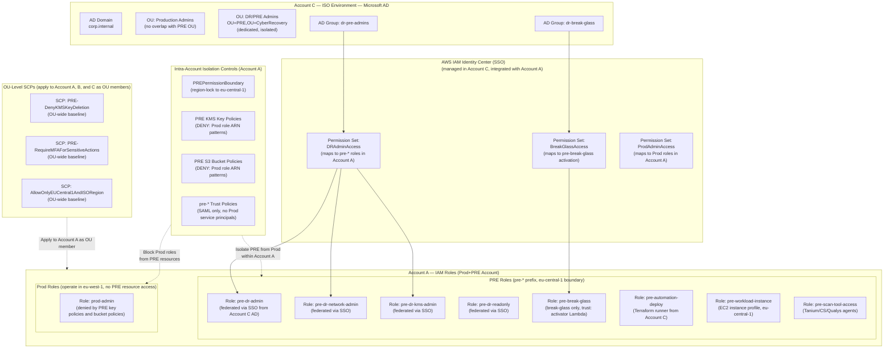

### IAM Role Definitions

**Role: `pre-dr-admin`** (Account A)

```json
{
  "RoleName": "pre-dr-admin",
  "Description": "Primary DR admin role for PRE environment management. Federated from ISO AD (Account C) via AWS IAM Identity Center. Permission boundary restricts all actions to eu-central-1 — cannot access Prod VPC resources in eu-west-1.",
  "AssumeRolePolicyDocument": {
    "Version": "2012-10-17",
    "Statement": [
      {
        "Effect": "Allow",
        "Principal": {
          "Federated": "arn:aws:iam::<ACCOUNT_A_ID>:saml-provider/ISOADProvider"
        },
        "Action": "sts:AssumeRoleWithSAML",
        "Condition": {
          "StringEquals": {
            "SAML:aud": "https://signin.aws.amazon.com/saml"
          },
          "Bool": {
            "aws:MultiFactorAuthPresent": "true"
          }
        }
      }
    ]
  },
  "PermissionBoundary": "arn:aws:iam::<ACCOUNT_A_ID>:policy/PREPermissionBoundary",
  "ManagedPolicies": [
    "arn:aws:iam::<ACCOUNT_A_ID>:policy/PREAdminPolicy",
    "arn:aws:iam::aws:policy/ReadOnlyAccess"
  ],
  "Tags": {
    "Environment": "PRE",
    "ManagedBy": "terraform",
    "Owner": "dr-team",
    "CostCenter": "cyber-recovery"
  }
}
```

**Policy: `PREPermissionBoundary`** (Account A — primary intra-account isolation mechanism)

```json
{
  "Version": "2012-10-17",
  "Statement": [
    {
      "Sid": "AllowPRERegionOnly",
      "Effect": "Allow",
      "Action": "*",
      "Resource": "*",
      "Condition": {
        "StringEquals": {
          "aws:RequestedRegion": ["eu-central-1"]
        }
      }
    },
    {
      "Sid": "DenyKMSKeyDeletionAndDisable",
      "Effect": "Deny",
      "Action": [
        "kms:DisableKey",
        "kms:DeleteImportedKeyMaterial",
        "kms:ScheduleKeyDeletion"
      ],
      "Resource": "*"
    },
    {
      "Sid": "DenyIAMPrivilegeEscalation",
      "Effect": "Deny",
      "Action": [
        "iam:CreatePolicyVersion",
        "iam:SetDefaultPolicyVersion",
        "iam:AttachRolePolicy",
        "iam:PutRolePolicy",
        "iam:PassRole"
      ],
      "Resource": "*",
      "Condition": {
        "StringNotEquals": {
          "aws:PrincipalTag/Role": "pre-dr-admin"
        }
      }
    },
    {
      "Sid": "DenyModifyBreakGlassRole",
      "Effect": "Deny",
      "Action": [
        "iam:UpdateRole",
        "iam:DeleteRole",
        "iam:DetachRolePolicy",
        "iam:DeleteRolePolicy"
      ],
      "Resource": "arn:aws:iam::<ACCOUNT_A_ID>:role/pre-break-glass"
    }
  ]
}
```

**Note on `DenyProdAccountAccess`**: In the original design, a `DenyProdAccountAccess` SID targeted `sts:AssumeRole` for `arn:aws:iam::<PROD_ACCOUNT_ID>:role/*`. Since Prod and PRE now share Account A, the account ID is the same — an SCP `DenyProdAccountTrust` targeting a different account ID is not applicable for intra-account isolation. Instead, the region-lock in `AllowPRERegionOnly` prevents PRE roles from performing any action in `eu-west-1` (Prod region). Prod roles are blocked from PRE resources via resource-based deny policies in KMS key policies and S3 bucket policies.

**Policy: `PREAdminPolicy`** (inline — full PRE management within boundary)

```json
{
  "Version": "2012-10-17",
  "Statement": [
    {
      "Sid": "PREComputeManagement",
      "Effect": "Allow",
      "Action": [
        "ec2:*",
        "autoscaling:*",
        "elasticloadbalancing:*"
      ],
      "Resource": "*",
      "Condition": {
        "StringEquals": {
          "aws:RequestedRegion": "eu-central-1",
          "ec2:ResourceTag/Environment": "PRE"
        }
      }
    },
    {
      "Sid": "PREStorageManagement",
      "Effect": "Allow",
      "Action": [
        "s3:*",
        "ebs:*",
        "backup:*"
      ],
      "Resource": [
        "arn:aws:s3:::pre-*",
        "arn:aws:s3:::pre-*/*"
      ]
    },
    {
      "Sid": "PREKMSUsage",
      "Effect": "Allow",
      "Action": [
        "kms:Encrypt",
        "kms:Decrypt",
        "kms:ReEncrypt*",
        "kms:GenerateDataKey*",
        "kms:DescribeKey"
      ],
      "Resource": "arn:aws:kms:eu-central-1:<ACCOUNT_A_ID>:key/*",
      "Condition": {
        "StringEquals": {
          "kms:ResourceAliases": "alias/pre-*"
        }
      }
    },
    {
      "Sid": "PRENetworkReadOnly",
      "Effect": "Allow",
      "Action": [
        "ec2:Describe*",
        "vpc:Describe*"
      ],
      "Resource": "*"
    },
    {
      "Sid": "PRESSMAccess",
      "Effect": "Allow",
      "Action": [
        "ssm:*",
        "ssmmessages:*",
        "ec2messages:*"
      ],
      "Resource": "*",
      "Condition": {
        "StringEquals": {
          "aws:RequestedRegion": "eu-central-1"
        }
      }
    },
    {
      "Sid": "PRECloudWatchLogs",
      "Effect": "Allow",
      "Action": [
        "logs:*",
        "cloudwatch:*",
        "cloudtrail:LookupEvents",
        "cloudtrail:GetTrailStatus"
      ],
      "Resource": "*"
    }
  ]
}
```

**Role: `pre-dr-kms-admin`** (Account A — KMS separation of duties)

```json
{
  "RoleName": "pre-dr-kms-admin",
  "Description": "Dedicated KMS administrator for PRE. Can manage KMS key policies and grants in eu-central-1 but cannot use keys for data operations. Strictly separate from general DR admin and Prod IAM roles. PRE KMS key policies additionally carry DENY statements for Prod role ARNs.",
  "ManagedPolicies": [
    "arn:aws:iam::<ACCOUNT_A_ID>:policy/PREKMSAdminPolicy"
  ]
}
```

```json
{
  "PolicyName": "PREKMSAdminPolicy",
  "Statement": [
    {
      "Sid": "KMSKeyAdministration",
      "Effect": "Allow",
      "Action": [
        "kms:Create*",
        "kms:Describe*",
        "kms:Enable*",
        "kms:List*",
        "kms:Put*",
        "kms:Update*",
        "kms:GetKeyPolicy",
        "kms:GetKeyRotationStatus",
        "kms:TagResource",
        "kms:UntagResource",
        "kms:EnableKeyRotation",
        "kms:DisableKeyRotation"
      ],
      "Resource": "arn:aws:kms:eu-central-1:<ACCOUNT_A_ID>:key/*"
    },
    {
      "Sid": "DenyKMSDataOperations",
      "Effect": "Deny",
      "Action": [
        "kms:Encrypt",
        "kms:Decrypt",
        "kms:ReEncrypt*",
        "kms:GenerateDataKey*"
      ],
      "Resource": "*"
    },
    {
      "Sid": "DenyKeyDeletion",
      "Effect": "Deny",
      "Action": [
        "kms:ScheduleKeyDeletion",
        "kms:DisableKey"
      ],
      "Resource": "*"
    }
  ]
}
```

**Role: `pre-break-glass`** (Account A — emergency access only)

```json
{
  "RoleName": "pre-break-glass",
  "Description": "Emergency break-glass role within Account A. Trust policy only allows the pre-break-glass-activator Lambda — not any Prod service principal, Prod role, or standard SAML path. All usage triggers immediate CloudWatch alarms and PagerDuty alerts.",
  "AssumeRolePolicyDocument": {
    "Statement": [
      {
        "Effect": "Allow",
        "Principal": {
          "AWS": "arn:aws:iam::<ACCOUNT_A_ID>:role/pre-break-glass-activator"
        },
        "Action": "sts:AssumeRole",
        "Condition": {
          "Bool": {
            "aws:MultiFactorAuthPresent": "true"
          },
          "StringEquals": {
            "sts:TransitiveTagKeys": "BreakGlassActivation"
          }
        }
      }
    ]
  },
  "ManagedPolicies": [
    "arn:aws:iam::aws:policy/AdministratorAccess"
  ],
  "MaxSessionDuration": 3600,
  "Tags": {
    "CriticalRole": "true",
    "MonitoredAccess": "true"
  }
}
```

**Service Control Policies (SCPs)** — OU-Level Baseline Guardrails

SCPs at the OU level apply to all three accounts (Account A, Account B, Account C) as baseline guardrails. They enforce minimum security posture across the OU.

**Critical constraint on SCP scope within Account A**: Because Prod VPC and PRE VPC reside in the same AWS account (Account A), SCPs cannot distinguish between Prod IAM principals and PRE IAM principals within that account. An SCP that says "deny Prod roles from accessing PRE resources" would require the SCP to reference role-name prefixes or resource tags, which SCPs do not support with sufficient granularity for all scenarios. Therefore:

- **Intra-account Prod/PRE isolation is NOT enforced by SCPs.** It is enforced by IAM permission boundaries (region-lock to `eu-central-1`), PRE role trust policies (SAML-only, no Prod service principals), and resource-based DENY policies on PRE KMS keys and S3 buckets targeting Prod IAM role ARN patterns (`arn:aws:iam::<ACCOUNT_A_ID>:role/prod-*`).
- **SCPs at the OU level provide supplementary OU-wide baseline guardrails** that benefit all three accounts (A, B, C) equally, as described below.
- **The original `PRE-DenyProdAccountTrust` SCP concept** (deny `sts:AssumeRole` targeting a separate Production account ID) is not applicable in this architecture since Prod and PRE share Account A — the account IDs are identical. Its intra-account equivalent is the `PREPermissionBoundary` region-lock (which prevents PRE roles from operating in `eu-west-1`) and resource-based DENY policies.

The SCPs below provide supplementary OU-wide protection:

```json
{
  "PolicyName": "PRE-DenyKMSKeyDeletion",
  "Description": "Applied to entire OU (Accounts A, B, C). Prevents scheduling KMS key deletion or disabling KMS keys without root-level authorization. Applies to both PRE KMS keys in Account A and IRE keys in Account B.",
  "Statement": [
    {
      "Sid": "DenyKMSKeyDeletion",
      "Effect": "Deny",
      "Action": [
        "kms:ScheduleKeyDeletion",
        "kms:DisableKey"
      ],
      "Resource": "*",
      "Condition": {
        "StringNotEquals": {
          "aws:PrincipalArn": "arn:aws:iam::*:root"
        }
      }
    }
  ]
}
```

```json
{
  "PolicyName": "PRE-RequireMFAForSensitiveActions",
  "Description": "Applied to entire OU (Accounts A, B, C). Requires MFA for sensitive KMS and IAM operations across all OU accounts.",
  "Statement": [
    {
      "Sid": "RequireMFAForKMSKeyAdmin",
      "Effect": "Deny",
      "Action": [
        "kms:DisableKey",
        "kms:ScheduleKeyDeletion",
        "kms:PutKeyPolicy",
        "kms:DeleteAlias"
      ],
      "Resource": "*",
      "Condition": {
        "BoolIfExists": {
          "aws:MultiFactorAuthPresent": "false"
        }
      }
    },
    {
      "Sid": "RequireMFAForIAMChanges",
      "Effect": "Deny",
      "Action": [
        "iam:AttachRolePolicy",
        "iam:PutRolePolicy",
        "iam:DeleteRole",
        "iam:CreateRole"
      ],
      "Resource": "*",
      "Condition": {
        "BoolIfExists": {
          "aws:MultiFactorAuthPresent": "false"
        }
      }
    }
  ]
}
```

```json
{
  "PolicyName": "PRE-DenyExternalVPCPeering",
  "Description": "Applied to entire OU (Accounts A, B, C). Prevents any account in the OU from accepting VPC peering requests from accounts outside the OU. This prevents an attacker from establishing a network path into Account A (or Account B/C) from an account outside the trust boundary.",
  "Statement": [
    {
      "Sid": "DenyVPCPeeringWithExternalAccounts",
      "Effect": "Deny",
      "Action": [
        "ec2:AcceptVpcPeeringConnection",
        "ec2:CreateVpcPeeringConnection"
      ],
      "Resource": "*",
      "Condition": {
        "StringNotEquals": {
          "aws:ResourceOrgID": "${aws:PrincipalOrgID}"
        }
      }
    }
  ]
}
```

> **Note**: Even within the OU, no VPC peering is created between the Prod VPC and the PRE VPC in Account A. The `PRE-DenyExternalVPCPeering` SCP only prevents peering with accounts *outside* the OU; the intra-account Prod/PRE VPC peering absence is enforced operationally (no peering connection is ever created) and monitored by the `intra-account-vpc-peering-absence` property test.

---

## KMS Key Hierarchy

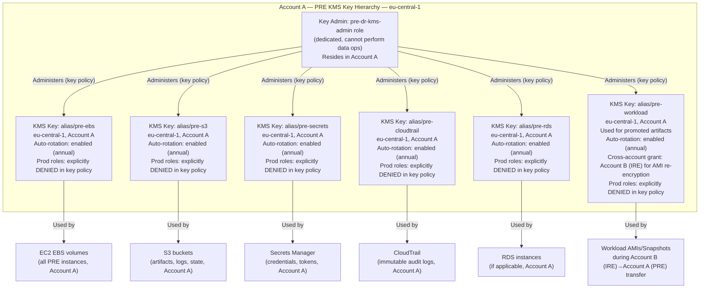

**KMS Key Policy Template (alias/pre-ebs) — with intra-account Prod role DENY**

```json
{
  "Version": "2012-10-17",
  "Id": "pre-ebs-encryption-key-policy",
  "Statement": [
    {
      "Sid": "EnableKeyAdministration",
      "Effect": "Allow",
      "Principal": {
        "AWS": [
          "arn:aws:iam::<ACCOUNT_A_ID>:role/pre-dr-kms-admin",
          "arn:aws:iam::<ACCOUNT_A_ID>:root"
        ]
      },
      "Action": [
        "kms:Create*",
        "kms:Describe*",
        "kms:Enable*",
        "kms:List*",
        "kms:Put*",
        "kms:Update*",
        "kms:GetKeyPolicy",
        "kms:EnableKeyRotation"
      ],
      "Resource": "*"
    },
    {
      "Sid": "AllowPREWorkloadUsage",
      "Effect": "Allow",
      "Principal": {
        "AWS": [
          "arn:aws:iam::<ACCOUNT_A_ID>:role/pre-dr-admin",
          "arn:aws:iam::<ACCOUNT_A_ID>:role/pre-workload-instance",
          "arn:aws:iam::<ACCOUNT_A_ID>:role/pre-automation-deploy"
        ]
      },
      "Action": [
        "kms:Encrypt",
        "kms:Decrypt",
        "kms:ReEncrypt*",
        "kms:GenerateDataKey*",
        "kms:DescribeKey",
        "kms:CreateGrant"
      ],
      "Resource": "*",
      "Condition": {
        "StringEquals": {
          "kms:ViaService": [
            "ec2.eu-central-1.amazonaws.com",
            "ebs.eu-central-1.amazonaws.com"
          ]
        }
      }
    },
    {
      "Sid": "DenyProdIAMRoleAccess",
      "Effect": "Deny",
      "Principal": "*",
      "Action": "kms:*",
      "Resource": "*",
      "Condition": {
        "ArnLike": {
          "aws:PrincipalArn": [
            "arn:aws:iam::<ACCOUNT_A_ID>:role/prod-*"
          ]
        }
      }
    },
    {
      "Sid": "DenyKeyDeletionByAll",
      "Effect": "Deny",
      "Principal": "*",
      "Action": [
        "kms:ScheduleKeyDeletion",
        "kms:DisableKey"
      ],
      "Resource": "*",
      "Condition": {
        "StringNotEquals": {
          "aws:PrincipalArn": "arn:aws:iam::<ACCOUNT_A_ID>:root"
        }
      }
    }
  ]
}
```

**Key Rotation and Lifecycle Policy:**

| Key Alias | Account | Rotation | Deletion Window | Cross-Account Grant | Notes |
|-----------|---------|----------|----------------|---------------------|-------|
| `alias/pre-ebs` | Account A | Annual (auto) | 30 days | Denied | EC2 EBS volumes only; Prod roles denied |
| `alias/pre-s3` | Account A | Annual (auto) | 30 days | Denied | S3 SSE-KMS; Prod roles denied |
| `alias/pre-secrets` | Account A | Annual (auto) | 30 days | Denied | Secrets Manager; Prod roles denied |
| `alias/pre-cloudtrail` | Account A | Annual (auto) | 30 days | Denied | Immutable log encryption; Prod roles denied |
| `alias/pre-rds` | Account A | Annual (auto) | 30 days | Denied | RDS/Aurora encryption; Prod roles denied |
| `alias/pre-workload` | Account A | On each recovery cycle | 7 days post-promotion | Account B (IRE) only (scoped grant) | Re-encrypt on PRE arrival; Prod roles denied |

---

## Network Configuration — VPC, Subnets, NACLs, Security Groups, TGW

### VPC Configuration

```
Account:         Account A (Prod+PRE Account)
VPC ID:          vpc-pre-eu-central-1
CIDR:            10.1.0.0/16
Region:          eu-central-1
DNS Hostnames:   Enabled
DNS Resolution:  Enabled (via ISO AD DNS in Account C via TGW)
Tenancy:         Default (can be Dedicated for high-sensitivity workloads)
VPC Flow Logs:   Enabled → CloudWatch Logs + dedicated S3 bucket (pre-vpc-flow-logs)
                 Format: ALL (accepted + rejected)
                 Traffic type: ALL
                 NOTE: Stored in separate buckets from Prod VPC flow logs (also in Account A)

Prod VPC (also Account A):
  CIDR:          10.0.0.0/16
  Region:        eu-west-1
  VPC Peering to PRE VPC: NONE (explicitly absent)
  Routing to PRE VPC: Only via RAM-shared TGW, which blackholes 10.1.0.0/16 on Prod attachment
                       during incident mode
```

### Subnet Design

| Subnet Name | CIDR | AZ | Purpose | Route Table |
|-------------|------|----|---------|-------------|
| `pre-mgmt-a` | `10.1.0.0/25` | eu-central-1a | Bastion hosts, SSM endpoints, DR admin access | `rt-pre-mgmt` |
| `pre-mgmt-b` | `10.1.0.128/25` | eu-central-1b | HA management subnet | `rt-pre-mgmt` |
| `pre-workload-a` | `10.1.1.0/25` | eu-central-1a | Recovered workload instances | `rt-pre-workload` |
| `pre-workload-b` | `10.1.1.128/25` | eu-central-1b | Recovered workload instances (HA) | `rt-pre-workload` |
| `pre-scan-a` | `10.1.2.0/25` | eu-central-1a | Security tool agents (Tanium, CrowdStrike, Qualys) | `rt-pre-scan` |
| `pre-scan-b` | `10.1.2.128/25` | eu-central-1b | Security tool agents (HA) | `rt-pre-scan` |
| `pre-egress-a` | `10.1.3.0/25` | eu-central-1a | NAT Gateway, controlled internet egress | `rt-pre-egress` |
| `pre-tgw-attach` | `10.1.4.0/28` | eu-central-1a | TGW attachment ENIs (RAM-shared TGW from Account C) | `rt-pre-tgw` |

### Route Tables

**Management Route Table (`rt-pre-mgmt`)**

```
Destination       Target              Purpose
10.1.0.0/16       local               VPC-local routing
10.2.0.0/16       tgw-attach          ISO Environment CIDR via RAM-shared TGW (Account C)
0.0.0.0/0         (no route)          No default internet route — SSM VPC endpoints used
```

**Workload Route Table (`rt-pre-workload`)**

```
Destination       Target              Purpose
10.1.0.0/16       local               VPC-local routing
10.2.0.0/16       tgw-attach          ISO shared services (AD auth, DNS, certs) via Account C TGW
0.0.0.0/0         nat-gw-pre-a        Controlled egress via NAT (Qualys cloud updates only)
```

**TGW Route Table (PRE attachment — managed in Account C, Account A has read access via RAM)**

```
Destination       Target              Purpose
10.1.0.0/16       pre-vpc-attachment  Routes into PRE VPC (Account A, eu-central-1)
10.0.0.0/16       BLACKHOLE           Prod VPC CIDR (Account A, eu-west-1) — blackholed during incident
10.2.0.0/16       iso-attachment      Routes to ISO shared services (Account C)

NOTE: TGW route tables are managed by Account C (ISO Account owner).
      Account A (Prod+PRE) cannot modify TGW route tables — only Account C can.
      This prevents any Prod-side compromise in Account A from re-routing traffic.
```

### Network ACLs

**NACL: `nacl-pre-mgmt`** (Management Subnet — Account A, eu-central-1)

| Rule | Direction | Protocol | Port Range | Source/Dest | Action | Reason |
|------|-----------|----------|-----------|-------------|--------|--------|
| 100 | Inbound | TCP | 443 | `10.2.0.0/16` (ISO Account C) | ALLOW | HTTPS from ISO shared services |
| 110 | Inbound | TCP | 389,636 | `10.2.0.0/16` (ISO Account C) | ALLOW | LDAP/LDAPS from ISO AD |
| 120 | Inbound | TCP | 53 | `10.2.0.0/16` (ISO Account C) | ALLOW | DNS from ISO |
| 130 | Inbound | UDP | 53 | `10.2.0.0/16` (ISO Account C) | ALLOW | DNS UDP from ISO |
| 140 | Inbound | TCP | 1024-65535 | `0.0.0.0/0` | ALLOW | Ephemeral return traffic |
| 150 | Inbound | TCP | 22 | `10.1.0.0/16` | ALLOW | SSH within PRE VPC (break-glass) |
| **50** | **Inbound** | **ALL** | **ALL** | **`10.0.0.0/16` (Prod VPC, same Account A)** | **DENY** | **Block all Prod VPC traffic (rule ≤ 50)** |
| * | Inbound | ALL | ALL | `0.0.0.0/0` | DENY | Default deny all |
| 100 | Outbound | TCP | 443 | `10.2.0.0/16` (ISO Account C) | ALLOW | HTTPS to ISO |
| 110 | Outbound | TCP | 389,636 | `10.2.0.0/16` (ISO Account C) | ALLOW | LDAP/LDAPS to ISO AD |
| 120 | Outbound | TCP | 53 | `10.2.0.0/16` (ISO Account C) | ALLOW | DNS to ISO |
| 130 | Outbound | UDP | 53 | `10.2.0.0/16` (ISO Account C) | ALLOW | DNS UDP to ISO |
| 140 | Outbound | TCP | 1024-65535 | `0.0.0.0/0` | ALLOW | Ephemeral return traffic |
| **50** | **Outbound** | **ALL** | **ALL** | **`10.0.0.0/16` (Prod VPC, same Account A)** | **DENY** | **Block all to Prod VPC (rule ≤ 50)** |
| * | Outbound | ALL | ALL | `0.0.0.0/0` | DENY | Default deny all |

**NACL: `nacl-pre-workload`** (Workload Subnet — Account A, eu-central-1)

| Rule | Direction | Protocol | Port Range | Source/Dest | Action | Reason |
|------|-----------|----------|-----------|-------------|--------|--------|
| 100 | Inbound | TCP | 443 | `10.1.0.0/25` (mgmt) | ALLOW | HTTPS from management subnet |
| 110 | Inbound | TCP | 22 | `10.1.0.0/25` (mgmt) | ALLOW | SSH from management subnet only |
| 120 | Inbound | TCP | 3389 | `10.1.0.0/25` (mgmt) | ALLOW | RDP from management subnet only |
| 130 | Inbound | TCP | 1024-65535 | `0.0.0.0/0` | ALLOW | Ephemeral return traffic |
| 140 | Inbound | ALL | ALL | `10.1.2.0/24` (scan) | ALLOW | Security tool agents |
| **50** | **Inbound** | **ALL** | **ALL** | **`10.0.0.0/16` (Prod VPC, same Account A)** | **DENY** | **Block Prod VPC (rule ≤ 50)** |
| * | Inbound | ALL | ALL | `0.0.0.0/0` | DENY | Default deny |
| 100 | Outbound | TCP | 443 | `0.0.0.0/0` | ALLOW | HTTPS egress (via NAT for updates) |
| 110 | Outbound | TCP | 1024-65535 | `0.0.0.0/0` | ALLOW | Ephemeral return |
| 120 | Outbound | ALL | ALL | `10.1.0.0/24` | ALLOW | Management subnet |
| 130 | Outbound | ALL | ALL | `10.1.2.0/24` | ALLOW | Scan subnet |
| **50** | **Outbound** | **ALL** | **ALL** | **`10.0.0.0/16` (Prod VPC, same Account A)** | **DENY** | **Block to Prod VPC (rule ≤ 50)** |
| * | Outbound | ALL | ALL | `0.0.0.0/0` | DENY | Default deny |

### Security Groups

**Security Group: `sg-pre-workload`** (Account A — recovered workload EC2 instances)

```
Inbound Rules:
  Protocol  Port       Source                    Description
  TCP       22         sg-pre-mgmt-bastion       SSH from management bastion only
  TCP       3389       sg-pre-mgmt-bastion       RDP from management bastion only
  TCP       443        sg-pre-mgmt-bastion       HTTPS management traffic
  ALL       ALL        sg-pre-scan-tools         Security tool access (Tanium/CS/Qualys)

Outbound Rules:
  Protocol  Port       Destination               Description
  TCP       443        0.0.0.0/0                 HTTPS for patching/security updates
  TCP       8732       sg-pre-scan-tools         Tanium agent callback
  UDP       53         10.2.x.x (ISO DNS, Account C)  DNS resolution via TGW
  ALL       ALL        sg-pre-scan-tools         Security tool communications
```

**Security Group: `sg-pre-mgmt-bastion`** (Account A — Management/bastion hosts)

```
Inbound Rules:
  Protocol  Port       Source                    Description
  TCP       443        10.2.0.0/16 (ISO Account C)   HTTPS from ISO network
  TCP       22         10.2.0.0/16 (ISO Account C)   SSH from ISO jump hosts

Outbound Rules:
  Protocol  Port       Destination               Description
  TCP       22         10.1.1.0/24               SSH to workload subnet
  TCP       3389       10.1.1.0/24               RDP to workload subnet
  TCP       443        10.2.0.0/16 (ISO Account C)   HTTPS to ISO services
  ALL       ALL        sg-pre-workload            Management access to workloads
```

**Security Group: `sg-pre-scan-tools`** (Account A — Tanium/CrowdStrike/Qualys agents)

```
Inbound Rules:
  Protocol  Port       Source                    Description
  TCP       8732       10.2.0.0/16               Tanium server callback (from ISO zone, Account C)
  TCP       443        10.2.0.0/16               CrowdStrike/Qualys HTTPS callouts

Outbound Rules:
  Protocol  Port       Destination               Description
  TCP       8732       0.0.0.0/0                 Tanium server communication (via TGW to Account C)
  TCP       443        0.0.0.0/0                 CrowdStrike/Qualys cloud connectivity
  ALL       ALL        sg-pre-workload            Agent-to-workload scanning
```

**Security Group: `sg-pre-vpc-endpoints`** (Account A — VPC Interface Endpoints)

```
Inbound Rules:
  Protocol  Port       Source                    Description
  TCP       443        10.1.0.0/16               All PRE VPC HTTPS access to AWS services

Outbound Rules:
  (No outbound rules — VPC endpoints are inbound-only)
```

### VPC Endpoints (Replacing Internet Routes for AWS Services)

| Endpoint | Type | Service | Subnets |
|----------|------|---------|---------|
| `vpce-pre-ssm` | Interface | `com.amazonaws.eu-central-1.ssm` | mgmt, workload |
| `vpce-pre-ssmmessages` | Interface | `com.amazonaws.eu-central-1.ssmmessages` | mgmt, workload |
| `vpce-pre-ec2messages` | Interface | `com.amazonaws.eu-central-1.ec2messages` | mgmt, workload |
| `vpce-pre-kms` | Interface | `com.amazonaws.eu-central-1.kms` | all |
| `vpce-pre-secretsmanager` | Interface | `com.amazonaws.eu-central-1.secretsmanager` | mgmt, workload |
| `vpce-pre-s3` | Gateway | `com.amazonaws.eu-central-1.s3` | all (route table) |
| `vpce-pre-ecr-api` | Interface | `com.amazonaws.eu-central-1.ecr.api` | workload |
| `vpce-pre-ecr-dkr` | Interface | `com.amazonaws.eu-central-1.ecr.dkr` | workload |
| `vpce-pre-cloudtrail` | Interface | `com.amazonaws.eu-central-1.cloudtrail` | mgmt |
| `vpce-pre-config` | Interface | `com.amazonaws.eu-central-1.config` | mgmt |

### Transit Gateway Configuration

**TGW Ownership and Sharing:**

```
TGW Owner:                Account C (ISO Account) — owns and manages the TGW
Shared via RAM to:        Account A (Prod+PRE Account), Account B (IRE Account)
TGW Management:           Only Account C can modify TGW route tables and attachments
                          Account A cannot modify TGW route tables — this prevents a
                          compromise in Account A from re-routing Prod VPC ↔ PRE VPC traffic
```

**TGW Attachment for PRE VPC (Account A):**

```
TGW ID:                   tgw-<id> (owned by Account C, shared via RAM to Account A)
Attachment Name:          tgw-attach-pre-vpc
VPC:                      vpc-pre-eu-central-1 (Account A, eu-central-1)
Subnets:                  pre-tgw-attach (10.1.4.0/28)
DNS Support:              Enabled
IPv6 Support:             Disabled
Appliance Mode:           Disabled

TGW Route Table Association: rt-pre-tgw-isolated
  (managed by Account C, separate from Prod VPC attachment route table)

Propagation:              Manual only (no auto-propagation)

Static Routes in rt-pre-tgw-isolated (managed by Account C):
  10.1.0.0/16   → tgw-attach-pre-vpc       (PRE VPC, Account A)
  10.2.0.0/16   → tgw-attach-iso-vpc       (ISO shared services, Account C)

  EXPLICITLY BLACKHOLED:
  10.0.0.0/16   → BLACKHOLE                (Prod VPC, Account A — blocked during incident)
```

**TGW Attachment for Prod VPC (Account A):**

```
TGW ID:                   tgw-<id> (same TGW, owned by Account C)
Attachment Name:          tgw-attach-prod-vpc
VPC:                      vpc-prod-eu-west-1 (Account A, eu-west-1)
TGW Route Table:          rt-prod-tgw (separate from PRE route table)
  — does NOT contain a route to 10.1.0.0/16 during incident mode
```

---

## Break-Glass Access Procedure

### Architecture

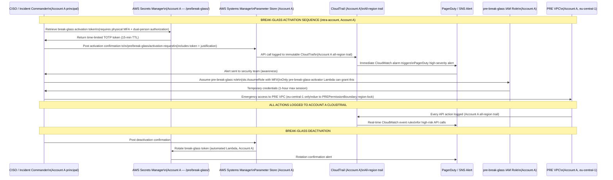

### Break-Glass Components (Account A)

**1. Break-Glass Vault (Secrets Manager — Account A)**

```
Secret Name:    /pre/break-glass/activation-credentials
Type:           TOTP seed (hardware-backed)
Account:        Account A
Rotation:       After every use + scheduled 90-day rotation
Access:         Restricted to pre-break-glass-vault-accessor role (Account A)
                Requires dual-person authorization (two distinct MFA tokens)
Encryption:     alias/pre-secrets KMS key (Account A, eu-central-1)
Versioning:     Enabled (retain 3 previous versions)
```

**2. Break-Glass Activation Lambda (Account A)**

```
Function Name:  pre-break-glass-activator
Account:        Account A
Runtime:        Python 3.12
Trigger:        SSM Parameter Store change event (via EventBridge, Account A)
Actions:
  1. Validates activation token from Secrets Manager (Account A)
  2. Verifies dual-person authorization (two distinct Account A IAM principals)
  3. Assumes pre-break-glass-activator role temporarily
  4. Grants sts:AssumeRole on pre-break-glass to requestor's IAM principal
  5. Sets 1-hour credential TTL
  6. Sends immediate notification to security team (SNS → PagerDuty)
  7. Logs all steps to immutable CloudTrail (Account A)
Environment Variables:
  BREAK_GLASS_ROLE_ARN: arn:aws:iam::<ACCOUNT_A_ID>:role/pre-break-glass
  ALERT_SNS_TOPIC_ARN:  arn:aws:sns:eu-central-1:<ACCOUNT_A_ID>:pre-break-glass-alerts
  MAX_SESSION_DURATION: 3600
```

**3. Break-Glass Monitoring (CloudWatch — Account A)**

```
Alarm: pre-break-glass-role-assumed
  Metric:   CloudTrailEventCount (Account A, all-region trail)
  Filter:   { $.eventName = "AssumeRole" && $.requestParameters.roleArn = "*pre-break-glass*" }
  Threshold: >= 1 within 1 minute
  Action:   SNS → PagerDuty P1 alert + Email to CISO + Security team

Alarm: pre-break-glass-console-login
  Metric:   CloudTrailEventCount (Account A, all-region trail)
  Filter:   { $.eventSource = "signin.amazonaws.com" && $.userIdentity.sessionContext.sessionIssuer.arn = "*pre-break-glass*" }
  Threshold: >= 1 within 1 minute
  Action:   SNS → PagerDuty P1 alert

EventBridge Rule: pre-break-glass-high-risk-actions
  Event Pattern:
    source: aws.iam, aws.kms, aws.ec2
    detail.userIdentity.sessionContext.sessionIssuer.arn: "*pre-break-glass*"
    detail.eventName: [DeleteRole, DisableKey, TerminateInstances, ...]
  Target: Lambda (security-incident-auto-responder, Account A)
```

**4. Break-Glass Procedure Runbook**

```
PRE-REQUISITES:
  - Physical MFA device registered for break-glass use (Account A principal)
  - Dual-person authorization: two authorized approvers must co-sign
  - Contact CISO and Security Operations before initiating

STEP 1: Declare break-glass event
  - Log incident in security ticketing system (reference number required)
  - Notify CISO and DR Team Lead
  - Record justification: incident ID, reason, expected duration

STEP 2: Retrieve activation token (requires 2 approvers, both Account A principals)
  - Approver 1: Authenticates to Secrets Manager with their MFA
  - Approver 2: Authenticates and co-signs the retrieval request
  - Retrieve TOTP token from /pre/break-glass/activation-credentials (Account A)
  - Token is valid for 15 minutes only

STEP 3: Submit activation request
  - POST to SSM Parameter /pre/break-glass/activation-request (Account A):
    {
      "incident_id": "<TICKET-ID>",
      "requestor_arn": "arn:aws:iam::<ACCOUNT_A_ID>:...",
      "approver_1_arn": "arn:aws:iam::<ACCOUNT_A_ID>:...",
      "approver_2_arn": "arn:aws:iam::<ACCOUNT_A_ID>:...",
      "justification": "<free text>",
      "totp_token": "<15-digit token>"
    }
  - Lambda validates and grants temporary assume-role permission

STEP 4: Assume break-glass role (Account A)
  aws sts assume-role \
    --role-arn arn:aws:iam::<ACCOUNT_A_ID>:role/pre-break-glass \
    --role-session-name "break-glass-<TICKET-ID>" \
    --serial-number <MFA_SERIAL> \
    --token-code <MFA_CODE> \
    --duration-seconds 3600

STEP 5: Perform required operations
  - ALL actions are logged to immutable CloudTrail (Account A, all-region trail)
  - Security team receives real-time alerts
  - Session expires automatically after 1 hour
  - PREPermissionBoundary restricts all actions to eu-central-1 — cannot access Prod VPC resources
  - Re-assumption requires new activation request

STEP 6: Deactivation
  - POST deactivation to /pre/break-glass/deactivation-request (Account A)
  - Lambda rotates break-glass token automatically (Account A Secrets Manager)
  - Document all actions taken in incident ticket
  - Security team reviews CloudTrail logs within 24 hours
```

---

## ISO Environment Connectivity — DR VPC to Shared Services (Account C)

### Connectivity Architecture

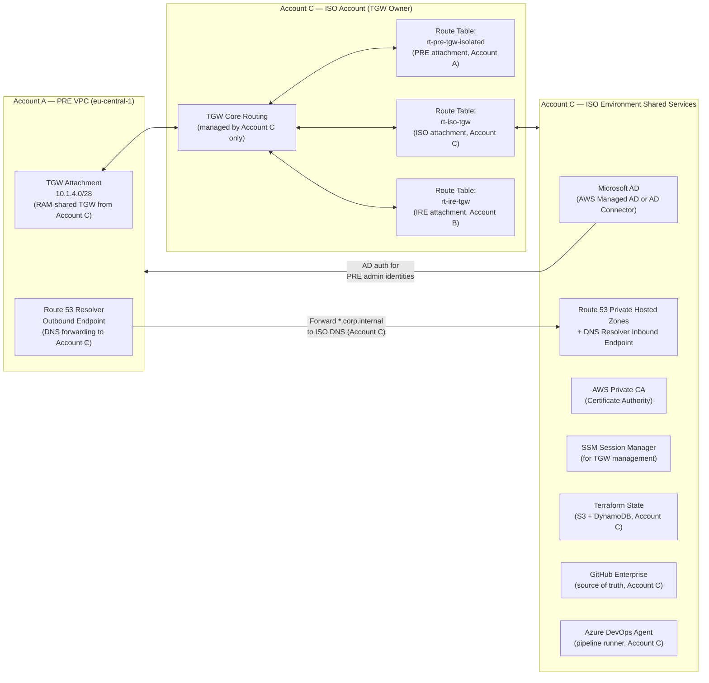

### DNS Configuration

**Route 53 Resolver — Outbound Endpoint (PRE VPC, Account A)**

```
Resource:        aws_route53_resolver_endpoint
Direction:       OUTBOUND
Name:            pre-resolver-outbound
IP Addresses:
  - Subnet: pre-mgmt-a  IP: 10.1.0.10
  - Subnet: pre-mgmt-b  IP: 10.1.0.138

Forwarding Rules:
  Domain: corp.internal        → ISO DNS Inbound Endpoint (10.2.x.x, Account C)
  Domain: internal.aws         → ISO DNS Inbound Endpoint (10.2.x.x, Account C)
  Domain: amazonaws.com        → (default Route 53 resolver)
  Domain: .                    → (default Route 53 resolver)
```

**Route 53 Private Hosted Zone (PRE, Account A)**

```
Zone Name:        pre.corp.internal
VPC Association:  vpc-pre-eu-central-1 (Account A, auto-associated)

Records:
  mgmt.pre.corp.internal       → 10.1.0.0/25 (management subnet)
  workload.pre.corp.internal   → 10.1.1.0/24 (workload subnet)
  scan.pre.corp.internal       → 10.1.2.0/24 (scan subnet)
  kms.pre.corp.internal        → VPC endpoint (kms)
  ssm.pre.corp.internal        → VPC endpoint (ssm)
```

### Microsoft AD Integration for PRE

```
AD Domain:          corp.internal (hosted in Account C ISO environment)
PRE Organizational Unit:
  OU=PRE,OU=CyberRecovery,DC=corp,DC=internal

Dedicated AD Groups (Account C AD, no overlap with Prod AD groups):
  CN=dr-pre-admins,OU=PRE         → Maps to: pre-dr-admin IAM role (Account A)
  CN=dr-pre-network,OU=PRE        → Maps to: pre-dr-network-admin IAM role (Account A)
  CN=dr-pre-kms,OU=PRE            → Maps to: pre-dr-kms-admin IAM role (Account A)
  CN=dr-pre-readonly,OU=PRE       → Maps to: pre-dr-readonly IAM role (Account A)
  CN=dr-break-glass,OU=PRE        → Maps to: pre-break-glass activation (Account A)

AD Connectivity:
  Protocol: LDAPS (port 636) — TLS only, no plain LDAP
  Path:     PRE VPC (Account A) → RAM-shared TGW (Account C) → ISO VPC (Account C) → ISO MSAD

AWS IAM Identity Center (SSO) SAML integration:
  IdP:      Microsoft AD via ADFS (hosted in Account C)
  SP:       AWS IAM Identity Center (Account C, integrated with Account A)
  MFA:      Required for all PRE role assignments (enforced by SAML assertion)
  Separation: DR admin permission sets map to pre-* roles in Account A;
              Prod admin permission sets map to Prod roles in Account A;
              No overlap between the two permission set groups
```

### Certificate Management

```
Certificate Authority:  AWS Private CA (hosted in Account C ISO environment)
CA ARN:                 arn:aws:acm-pca:eu-west-1:<ACCOUNT_C_ID>:certificate-authority/<id>

PRE Certificate Issuance:
  - PRE instances (Account A) request certs via ACM Private CA endpoint (via RAM-shared TGW to Account C)
  - CRL distribution point accessible from PRE VPC (via private S3 endpoint)
  - Certificate templates for:
    - Internal HTTPS endpoints
    - Workload mutual TLS
    - Security tool agent authentication

PKI Path:
  PRE workload (Account A) → ACM Private CA API (via TGW to Account C) → ISO Private CA
                           → Certificate issued → PRE Secrets Manager (Account A, encrypted with alias/pre-secrets)
```

---

## Security Tool Integration (Tanium, CrowdStrike, Qualys)

### Integration Architecture

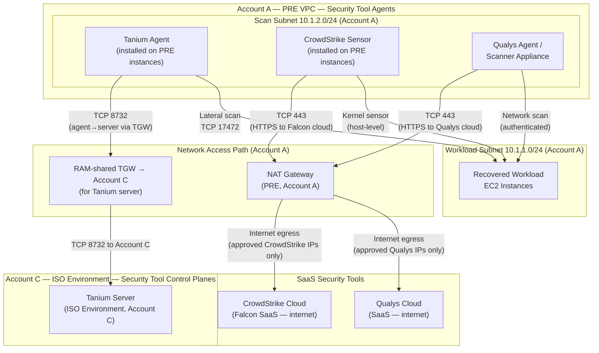

### Tanium Integration (Account A PRE VPC, connects to Account C ISO)

```
Deployment Model:   Agent-based (installed on all PRE EC2 instances at launch via EC2 user-data)
Server Location:    Account C ISO Environment (existing Tanium server, pre-approved access via TGW)
Agent Version:      Pinned to ISO-approved version (via SSM Parameter Store, Account A)
Communication:      TCP 8732 (PRE VPC Account A → RAM-shared TGW → Account C ISO)

IAM Role for Tanium (pre-scan-tool-access, Account A):
  Permissions:
    - ssm:GetParameter (read Tanium registration token from Parameter Store, Account A)
    - s3:PutObject (upload scan results to pre-scan-results-bucket, Account A)
    - logs:PutLogEvents (write Tanium telemetry to CloudWatch, Account A)

Security Group: sg-pre-scan-tools inbound: TCP 17472 from sg-pre-workload (agent-to-agent)
                sg-pre-scan-tools outbound: TCP 8732 to 10.2.0.0/16 (Account C Tanium server via TGW)

Tanium Modules Active in PRE:
  - Tanium Protect (host firewall + application control)
  - Tanium Detect (threat detection + EDR)
  - Tanium Comply (compliance scanning)
  - Tanium Discover (asset inventory)

User-data script (EC2 launch, Account A):
  #!/bin/bash
  TANIUM_TOKEN=$(aws ssm get-parameter --name /pre/tanium/registration-token \
                 --with-decryption --region eu-central-1 \
                 --query Parameter.Value --output text)
  TANIUM_SERVER=$(aws ssm get-parameter --name /pre/tanium/server-address \
                  --region eu-central-1 --query Parameter.Value --output text)
  curl -O https://pre-artifacts-bucket.s3.eu-central-1.amazonaws.com/tanium/TaniumClient.rpm
  rpm -ivh TaniumClient.rpm
  /opt/Tanium/TaniumClient/TaniumClient config set ServerNameList $TANIUM_SERVER
  /opt/Tanium/TaniumClient/TaniumClient config set LogVerbosityLevel 1
  systemctl start TaniumClient && systemctl enable TaniumClient
```

### CrowdStrike Integration (Account A PRE VPC, connects to SaaS)

```
Deployment Model:   Kernel-level sensor (installed on all PRE instances, Account A)
Console:            Falcon SaaS (crowdstrike.com)
Communication:      HTTPS (TCP 443) to Falcon cloud via NAT Gateway (Account A)

Falcon CID:         <PRE-specific CID or shared CID with PRE tag>
Sensor Tags:        "PRE", "cyber-recovery", "eu-central-1", "AccountA"
Prevention Policy:  PRE-Hardened (strict prevention mode during recovery)

Egress Allow (NAT Gateway SG, Account A):
  Outbound TCP 443 to CrowdStrike IP ranges (stored in SSM Parameter Store Account A):
    35.191.0.0/16    (Falcon US-1)
    162.254.0.0/16   (Falcon cloud)

IAM for CS (pre-scan-tool-access supplementary, Account A):
  - s3:PutObject → pre-scan-results-* (upload detection logs, Account A)
  - cloudwatch:PutMetricData (operational metrics, Account A)

Installation via SSM Run Command (Account A):
  aws ssm send-command \
    --instance-ids $(get_all_pre_instances) \
    --document-name "AWS-RunShellScript" \
    --parameters commands=["
      CS_CID=$(aws ssm get-parameter --name /pre/crowdstrike/cid --with-decryption --output text --query Parameter.Value)
      curl -O https://pre-artifacts-bucket.s3.eu-central-1.amazonaws.com/crowdstrike/falcon-sensor.rpm
      rpm -ivh falcon-sensor.rpm
      /opt/CrowdStrike/falconctl -s --cid=$CS_CID --tags='PRE,cyber-recovery'
      systemctl start falcon-sensor
    "]
```

### Qualys Integration (Account A PRE VPC, connects to SaaS)

```
Deployment Model:   Cloud Agent + Virtual Scanner Appliance in PRE scan subnet (Account A)
Console:            Qualys Cloud Platform (SaaS)
Communication:      HTTPS (TCP 443) to Qualys cloud via NAT Gateway (Account A)

Scanner Appliance:
  Instance:         t3.medium in pre-scan-a subnet (Account A)
  SG:               sg-pre-scan-tools
  IAM:              pre-scan-tool-access role (Account A)
  Scan Scope:       10.1.1.0/24 (workload subnet, Account A) — authenticated scans

Cloud Agent:
  Installed on:     All PRE workload EC2 instances (Account A)
  Communication:    TCP 443 outbound to Qualys cloud (via NAT, Account A)

Scan Profiles:
  - Initial restore scan: Full vulnerability scan + malware detection (immediate on workload arrival)
  - Continuous scan:      Weekly scheduled scan during PRE staging
  - Pre-promotion scan:   Full scan 24 hours before promotion gate

Qualys Activation Key: Stored in Secrets Manager (/pre/qualys/activation-key, Account A)
                        Encrypted with alias/pre-secrets (Account A, eu-central-1)
```

---

## Workload Promotion Workflow: IRE (Account B) → PRE (Account A) → Production (Account A)

### Promotion State Machine

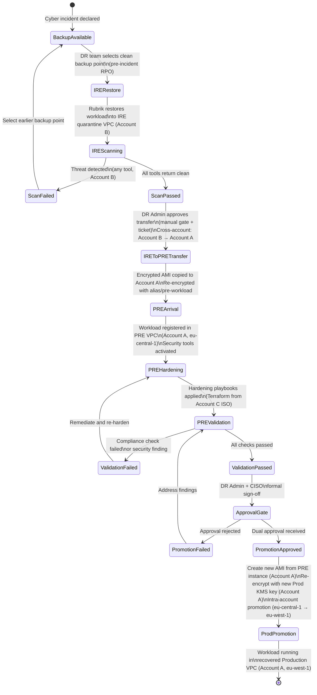

### IRE (Account B) → PRE (Account A) Transfer Mechanism

```
Transfer Method:   AWS cross-account AMI copy + re-encryption
                   (NOT direct network connection — prevents lateral movement)
                   Account B (IRE) → Account A (PRE)

Step-by-step:
  1. In Account B (IRE):
     a. Create final AMI of cleansed workload instance
     b. Encrypt AMI snapshot with IRE KMS key (alias/ire-workload, Account B)
     c. Share AMI snapshot with Account A ID (modify-snapshot-attribute)

  2. Cross-account snapshot share (Account B → Account A):
     aws ec2 modify-snapshot-attribute \
       --snapshot-id snap-<IRE_SNAPSHOT_ID> \
       --attribute createVolumePermission \
       --operation-type add \
       --user-ids <ACCOUNT_A_ID>

  3. In Account A (PRE):
     a. Copy AMI from Account B with re-encryption using alias/pre-workload (Account A, eu-central-1)
     aws ec2 copy-image \
       --source-region eu-central-1 \
       --source-image-id ami-<ACCOUNT_B_IRE_AMI_ID> \
       --name "pre-restored-<WORKLOAD>-<DATE>" \
       --encrypted \
       --kms-key-id alias/pre-workload \
       --region eu-central-1

     b. Verify AMI integrity (checksum validation Lambda, Account A)
     c. Register AMI in PRE SSM inventory (Account A)
     d. Remove cross-account share from Account B side

  4. Launch in PRE workload subnet (Account A, eu-central-1):
     aws ec2 run-instances \
       --image-id ami-<ACCOUNT_A_PRE_COPIED_AMI_ID> \
       --instance-type <WORKLOAD_TYPE> \
       --subnet-id subnet-pre-workload-a \
       --security-group-ids sg-pre-workload \
       --iam-instance-profile pre-workload-instance \
       --ebs-optimized \
       --block-device-mappings '[{
         "DeviceName": "/dev/xvda",
         "Ebs": {"VolumeType": "gp3", "Encrypted": true, "KmsKeyId": "alias/pre-ebs"}
       }]' \
       --tag-specifications 'ResourceType=instance,Tags=[
         {Key=Environment,Value=PRE},
         {Key=Workload,Value=<NAME>},
         {Key=IncidentID,Value=<TICKET>},
         {Key=RestoredFrom,Value=<ACCOUNT_B_IRE_AMI_ID>},
         {Key=SourceAccount,Value=AccountB-IRE},
         {Key=RestoreDate,Value=<DATE>}
       ]'
```

### PRE Hardening Playbooks (Terraform from Account C)

```
Terraform Source:   GitHub (Account C ISO) → Azure DevOps Pipeline (Account C) → deploys to Account A PRE
State Backend:      S3 (Account C) + DynamoDB lock (Account C)
                    State files NOT stored in Account A — prevents Account A principals from tampering
                    with IaC state

Hardening Modules Applied (order-dependent):
  1. module/pre-os-baseline
     - Disable unused services, ports
     - Enable auditd, enforce SELinux/AppArmor
     - Apply CIS benchmark Level 2

  2. module/pre-patch-management
     - Apply all OS security patches (via SSM Patch Manager, Account A)
     - Reboot if kernel updates applied
     - Verify patch compliance score ≥ 95%

  3. module/pre-iam-instance-hardening
     - Remove any IAM credentials found on disk
     - Verify instance profile = pre-workload-instance only (Account A)
     - Disable instance metadata v1 (IMDSv2 only)

     aws ec2 modify-instance-metadata-options \
       --instance-id <INSTANCE_ID> \
       --http-tokens required \
       --http-endpoint enabled \
       --http-put-response-hop-limit 1

  4. module/pre-network-hardening
     - Apply host firewall rules (iptables/nftables)
     - Disable IPv6 (unless required)
     - Verify security group compliance

  5. module/pre-security-tool-verification
     - Confirm Tanium agent running and registered (Account C ISO server)
     - Confirm CrowdStrike sensor running (kernel module loaded)
     - Confirm Qualys agent registered and reporting

  6. module/pre-compliance-scan
     - Run AWS Config rules evaluation (Account A, eu-central-1)
     - Run Qualys compliance scan
     - Fail pipeline if critical findings remain
```

### Promotion Gate Checklist

```
AUTOMATED CHECKS (must all pass before manual review):
  [ ] All Tanium Comply checks passed (CIS Level 2 ≥ 95%)
  [ ] CrowdStrike: No active detections on instance
  [ ] Qualys: No Critical or High CVEs unpatched
  [ ] AWS Config: 0 non-compliant rules (Account A, eu-central-1)
  [ ] VPC Flow Logs: No anomalous outbound connections during PRE staging
  [ ] SSM Patch Manager: Compliance = "Compliant"
  [ ] IMDSv2: Enforced (hop limit = 1)
  [ ] EBS encryption: Verified (alias/pre-ebs, Account A)
  [ ] Security groups: Matches approved baseline (automated diff)
  [ ] No leftover credentials/keys on disk (Tanium Discover check)

MANUAL APPROVAL GATE (dual sign-off required):
  [ ] DR Team Lead sign-off (documents all automated check results)
  [ ] CISO or delegate sign-off (reviews security tool findings)
  [ ] Incident ticket updated with promotion rationale
  [ ] Rollback plan documented

PROMOTION STEPS (post-approval, intra-account Account A):
  1. Create final AMI from PRE instance (Account A, eu-central-1)
  2. Re-encrypt snapshot with new Prod KMS key (Account A, eu-west-1 or eu-central-1 — new key, NOT alias/pre-workload)
  3. Share AMI with Prod VPC workload deployment (intra-account copy, Account A)
  4. Deploy to Production VPC via Terraform pipeline (Account C → Account A, eu-west-1)
  5. Decommission PRE instances after Prod validation
  6. Rotate all PRE credentials and keys post-recovery
  7. Archive PRE CloudTrail logs to Glacier (7-year retention, Account A Object Lock buckets)
```

---

## Logging, Monitoring, and Compliance

### Audit Trail Configuration

```
CloudTrail (Account A):
  Trail Name:         pre-audit-trail
  Scope:              All regions in Account A (covers both eu-central-1 PRE and eu-west-1 Prod)
                      CloudWatch metric filters and log group subscriptions are used to separate
                      PRE-region (eu-central-1) API calls from Prod-region (eu-west-1) API calls
  S3 Bucket:          pre-cloudtrail-logs-<ACCOUNT_A_ID>
                      (PRE-dedicated bucket, separate from any Prod CloudTrail bucket)
  Log file validation: Enabled (SHA-256 digest files)
  KMS Encryption:     alias/pre-cloudtrail (Account A, eu-central-1)
  S3 Object Lock:     COMPLIANCE mode, 7 years
  SNS Topic:          pre-cloudtrail-alerts (for real-time processing, Account A)

  EventBridge/CloudWatch Filters to Distinguish PRE Activity:
    Filter 1: eventRegion = eu-central-1 AND userIdentity.arn matches pre-* roles
    Filter 2: eventRegion = eu-central-1 (all PRE-region API calls)
    These filters feed PRE-specific CloudWatch log groups and alarms

CloudWatch Log Groups (Account A):
  /pre/vpc-flow-logs          Retention: 90 days → S3 archive 7 years
                              (PRE VPC only; Prod VPC flow logs stored in separate /prod/vpc-flow-logs)
  /pre/ssm-session-manager    Retention: 365 days (all session activity by pre-* roles)
  /pre/security-tools         Retention: 365 days (Tanium/CS/Qualys)
  /pre/break-glass            Retention: 7 years (compliance)
  /pre/workload-os-logs       Retention: 90 days

AWS Config (Account A, eu-central-1):
  Recorder:         All resource types in eu-central-1
                    (separate from any Prod Config recorder in eu-west-1)
  Delivery Channel: S3 (pre-config-logs bucket, Account A, Object Lock enabled)
  Rules:
    - encrypted-volumes (all EBS must use alias/pre-ebs)
    - restricted-ssh (SG must not have 0.0.0.0/0 for port 22)
    - restricted-common-ports (block well-known ports from internet)
    - iam-no-inline-policies (enforce managed policies)
    - root-account-mfa-enabled
    - s3-bucket-server-side-encryption-enabled
    - vpc-flow-logs-enabled
    - cloud-trail-encryption-enabled
    - iam-password-policy (enforce strong password policy)
    - kms-key-rotation-enabled
    - tgw-no-prod-routes (custom: PRE TGW attachment route table must not route to Prod VPC CIDR)
    - iam-no-prod-role-trust-in-pre (custom: pre-* roles must not trust any Prod IAM service principals
      or Prod role ARNs in Account A — evaluated as intra-account role trust check since Prod and PRE
      share Account A; flags any pre-* role whose AssumeRolePolicyDocument Principal matches
      arn:aws:iam::<ACCOUNT_A_ID>:role/prod-* or any Prod EC2/Lambda service principal context)
```

---

## Summary of Architecture Decisions

| Decision | Choice | Rationale |
|----------|--------|-----------|
| Account structure | Prod VPC and PRE VPC in Account A; IRE in Account B; ISO + TGW in Account C | Reflects actual deployed structure; isolation enforced at IAM and network layers within Account A |
| TGW ownership | Owned by Account C (ISO), shared via RAM to Account A and Account B | Account A (which also hosts Prod) cannot modify TGW route tables; Account C controls all routing between zones |
| Intra-account Prod/PRE isolation | Permission boundaries (region-lock), role trust policies (SAML only), resource-based deny policies on PRE KMS keys and S3 buckets | SCPs cannot isolate within the same account; IAM and resource policies are the authoritative intra-account isolation mechanism |
| SCPs (OU level) | `PRE-DenyKMSKeyDeletion`, `PRE-RequireMFAForSensitiveActions`, `PRE-DenyExternalVPCPeering` applied to all three accounts | SCPs provide baseline OU-wide guardrails; `PRE-DenyProdAccountTrust` SCP concept is not applicable since Prod and PRE share Account A — its function is replaced by IAM permission boundaries and resource-based deny policies |
| PRE base | Existing DR VPC (`eu-central-1`, Account A) | Reduces provisioning time; existing infrastructure with known topology; re-use within same account avoids cross-account complexity |
| Admin identity | Dedicated AD OU in Account C, separate permission sets in IAM Identity Center | No credential overlap between DR admins and Prod admins; attack on Prod admin credentials cannot be used to assume PRE roles |
| KMS keys | Independent PRE key ring in Account A (`eu-central-1`); `pre-dr-kms-admin` role separate from general admin; Prod role ARNs explicitly denied in key policies | Prod roles and PRE roles share Account A, so resource-based DENY in key policy is the authoritative cross-role isolation control |
| Prod→PRE VPC network | TGW route blackholed on PRE attachment (Account C managed) + NACL explicit deny | Defense in depth; TGW blackhole managed by Account C (not Account A) prevents Account A compromise from re-routing; NACL adds second layer within Account A |
| IRE→PRE transfer | Cross-account AMI copy (Account B → Account A) with re-encryption; no network path | True cross-account operation preserving artifact-only transfer; prevents any malware from using network to propagate |
| Break-glass | Account A IAM role, trust policy allows only `pre-break-glass-activator` Lambda; dual-person authorization via Account A Secrets Manager | Intra-account role, but isolated from Prod role trust chains; dual approval prevents insider threat |
| Security tools | Tanium (Account C ISO server via TGW) + CrowdStrike (SaaS via NAT) + Qualys (SaaS via NAT) | Consistent tooling across Account B (IRE) and Account A (PRE); pre-approved access patterns |
| Terraform state | Account C (ISO) S3/DynamoDB | Account A cannot modify its own IaC; state lives in Account C outside Account A trust boundary |
| CloudTrail | Account A all-region trail; PRE-dedicated S3 bucket with Object Lock | Single trail covers both Prod and PRE API activity; CloudWatch filters (eventRegion = eu-central-1 AND userIdentity.arn matches pre-* roles) separate PRE events; dedicated bucket prefix `pre-*` and tag `Environment=PRE` prevent Prod admin from tampering with PRE audit logs |
